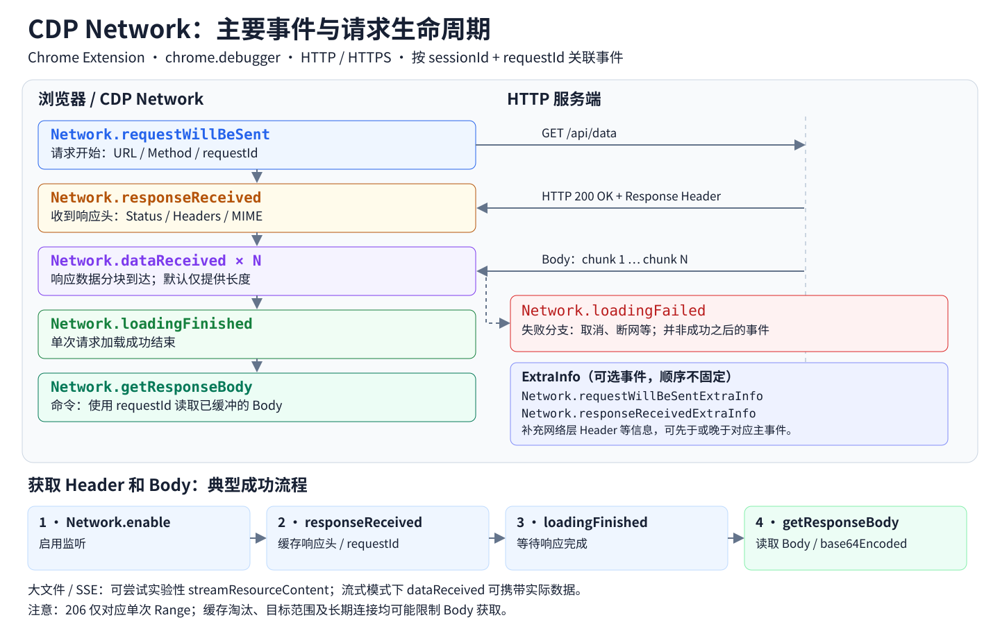

# 网页调用自己的 Chrome 扩展

网页用扩展 ID 发送消息，Chrome 按站点白名单放行，扩展后台处理并回复。下面用 Manifest V3 跑通 `PING` / `PONG`。

## 扩展

`extension/manifest.json`

```json
{
  "manifest_version": 3,
  "name": "Web Extension Demo",
  "version": "1.0.0",
  "background": { "service_worker": "background.js" },
  "externally_connectable": { "matches": ["http://127.0.0.1/*"] }
}
```

`extension/background.js`

```js
const allowedOrigin = "http://127.0.0.1:8000";

chrome.runtime.onMessageExternal.addListener((message, sender, reply) => {
  if (sender.origin !== allowedOrigin || message?.type !== "PING") {
    reply({ ok: false, error: "请求未获授权" });
    return;
  }

  reply({ ok: true, result: "PONG" });
});
```

## 网页

`web/index.html`

```html
<!doctype html>
<meta charset="utf-8">
<title>网页调用扩展</title>
<button id="ping">调用扩展</button>
<pre id="result"></pre>
<script>
  const extensionId = "替换为实际扩展 ID";
  const output = document.querySelector("#result");

  document.querySelector("#ping").addEventListener("click", () => {
    if (!window.chrome?.runtime?.sendMessage) {
      output.textContent = "请检查扩展是否启用、网页地址是否匹配";
      return;
    }

    chrome.runtime.sendMessage(extensionId, { type: "PING" }, (response) => {
      const error = chrome.runtime.lastError;
      output.textContent = error?.message ?? response?.result ?? response?.error ?? "扩展未回复";
    });
  });
</script>
```

## 本机验证

1. 打开 `chrome://extensions`，开启开发者模式，点「加载已解压的扩展程序」并选择 `extension/`。复制扩展 ID，填入 `web/index.html`。
2. 在包含这两个目录的位置运行 `python3 -m http.server 8000 --bind 127.0.0.1 --directory web`。
3. 用 Chrome 打开 `http://127.0.0.1:8000/`，点击「调用扩展」，页面应显示 `PONG`。

部署时，把 `matches` 和 `allowedOrigin` 改为你的 HTTPS 站点。后台按完整来源（协议、主机、端口）和命令类型校验每条消息。

[Chrome 扩展消息通信](https://developer.chrome.com/docs/extensions/develop/concepts/messaging#external-webpage) · [站点白名单配置](https://developer.chrome.com/docs/extensions/reference/manifest/externally-connectable)

## Chrome Debugger：Network 请求事件与响应体

通过 `chrome.debugger` 调用 CDP Network 域，在用户主动开启的授权调试标签页内观察 HTTP/HTTPS 请求。下图为请求生命周期的 SVG 矢量示意图。



[查看高清矢量图（SVG）](./chrome-cdp-network-events.svg)

典型成功流程：`Network.enable` → `requestWillBeSent` → `responseReceived` → `dataReceived`（可多次）→ `loadingFinished` → 调用 `Network.getResponseBody`。

- 使用当前 CDP 会话及 `requestId` 关联响应头与响应体。
- `loadingFailed` 是失败分支；ExtraInfo 事件可选，且与对应主事件的先后顺序不固定。
- `getResponseBody` 是命令而非事件；单次 Range 请求只对应本次响应的数据，且大响应体可能受到缓冲限制。持续流式响应可评估实验性接口 `Network.streamResourceContent`。
- 调试权限较高，仅在用户明确授权的范围内使用，默认不上传或持久化敏感响应。

[Chrome Debugger API](https://developer.chrome.com/docs/extensions/reference/api/debugger/) · [CDP Network](https://chromedevtools.github.io/devtools-protocol/tot/Network/)
