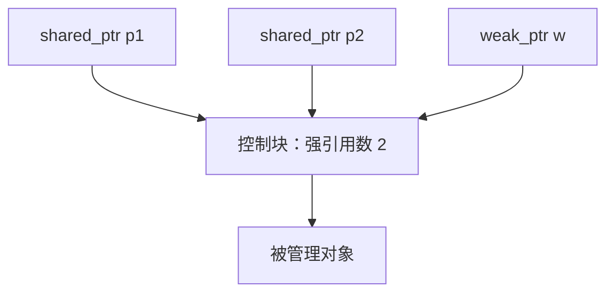

# C++ 智能指针与 lock_guard：生命周期绑定及实现原理

## 1. 核心理解：让对象自动管理资源

可以把它理解为：**将资源的管理责任，绑定到一个管理对象的生命周期上。管理对象析构时，自动执行对应的清理操作。**

这种方法叫 **RAII（Resource Acquisition Is Initialization，资源获取即初始化）**。管理对象在初始化时获取或接管资源，在析构时释放资源。

这里的“资源”不仅可以是堆上的对象，也可以是锁、文件、网络连接等。

| 管理对象 | 管理什么 | 析构时的行为 |
| --- | --- | --- |
| `unique_ptr` | 独占的对象 | 调用删除器，通常是 `delete` |
| `shared_ptr` | 对对象的共享所有权 | 强引用数减 1，最后一个所有者释放时销毁对象 |
| `weak_ptr` | 对共享对象的观察关系 | 释放对控制块的弱引用，不负责维持对象存活 |
| `lock_guard` | 当前线程持有锁的责任 | 调用互斥量的 `unlock()` |

**“两个对象的生命周期绑定”适合理解独占所有权；对共享所有权，要看所有管理对象共同持有资源的时间；对锁，要绑定的是持锁时间。**

## 2. 为什么离开作用域会自动清理？

C++ 会在自动存储期对象离开作用域时调用其析构函数。对于这样的局部变量，正常执行结束、提前 `return`、抛异常后栈展开，都可以触发析构。

```cpp
{
    auto p = std::make_unique<User>();
    std::lock_guard<std::mutex> guard(m);

    // 使用 User，并持有锁
}
// 按构造的逆序析构：先 guard 解锁，再 p 销毁 User
```

这里存在两个不同的对象：局部变量 `p`，以及堆上由 `p` 管理的 `User`。`p` 的析构函数负责销毁 `User`。

因此，**只有存储一个普通指针，并不会自动销毁它指向的对象；必须在管理类中实现相应的析构逻辑。**

RAII 依赖析构实际发生。进程被强制终止等情况下，不能指望局部对象完成清理。

## 3. unique_ptr：独占所有权

### 3.1 基本使用

```cpp
auto p1 = std::make_unique<int>(100);
auto p2 = std::move(p1);

// p1 为空，p2 接管原对象；std::move 本身不搬运对象，移动构造完成转交
// p2 析构时，自动删除原来的 int
```

它的核心组成是：**指针 + 删除器 + 禁止复制 + 允许移动。**

禁止复制，是为了防止两个独占管理者同时负责删除同一个对象；允许移动，是为了转交所有权，而不复制被管理对象。

### 3.2 简化实现

以下代码仅管理通过 `new T` 创建的单个对象，省略自定义删除器、数组和其他标准库接口。

```cpp
#include <utility>

template<class T>
class UniquePtr {
    T* ptr_;

public:
    explicit UniquePtr(T* p = nullptr) noexcept : ptr_(p) {}

    ~UniquePtr() {
        delete ptr_;
    }

    UniquePtr(const UniquePtr&) = delete;
    UniquePtr& operator=(const UniquePtr&) = delete;

    UniquePtr(UniquePtr&& other) noexcept
        : ptr_(std::exchange(other.ptr_, nullptr)) {}

    UniquePtr& operator=(UniquePtr&& other) noexcept {
        if (this != &other) {
            delete ptr_;
            ptr_ = std::exchange(other.ptr_, nullptr);
        }
        return *this;
    }

    T& operator*() const { return *ptr_; }
    T* operator->() const noexcept { return ptr_; }
    T* get() const noexcept { return ptr_; }
};
```

`operator*`、`operator->` 让它在使用方式上接近指针；真正负责自动清理的是析构函数。访问前仍要保证指针非空。

移动后源指针置空，其析构执行 `delete nullptr` 是安全的。`get()` 仅提供原始地址，不转移所有权，不能因此再手动 `delete`。

标准 `unique_ptr::reset()` 可以提前释放或替换对象；`release()` 则放弃管理并返回原始指针，不删除对象。因此，即使是独占管理，资源也不一定要等到管理对象析构才释放。

## 4. shared_ptr：控制块与引用计数

### 4.1 多个管理对象，共同维持一个对象存活

```cpp
auto p1 = std::make_shared<int>(100); // 强引用数 1
auto p2 = p1;                        // 强引用数 2
p1.reset();                          // 强引用数 1，对象仍然存在
p2.reset();                          // 强引用数 0，对象被销毁
```

复制 `shared_ptr` 通常只复制管理信息并增加计数，**不会复制它指向的对象**。移动则转交管理信息，通常不改变强引用总数。

常见实现中，每个 `shared_ptr` 保存访问对象的指针和控制块指针；控制块记录引用计数以及销毁对象所需的信息。



图中展示的是所有权管理关系。`shared_ptr` 通常还直接保存用于访问对象的地址；在别名构造等用法中，该地址可以与实际被管理对象的地址不同。

控制块概念上包含：

```cpp
// 结构示意，省略实现细节
struct ControlBlock {
    std::atomic<long> strong_count;
    std::atomic<long> weak_count;
    // 销毁对象、释放控制块所需的信息：删除器、分配器等
};
```

### 4.2 为什么分成对象与控制块？

两者的生命周期不同：

1. 强引用数减到 0：销毁被管理对象。
2. 对象已销毁，但仍有 `weak_ptr`：保留控制块，用于判断对象是否已过期。
3. 不再有任何引用需要控制块：释放控制块。

常见实现的弱计数还包含一份“仍有强引用存在”的隐含引用，不能直接当成 `weak_ptr` 实例的个数。

`make_shared<T>()` 通常将对象和控制块合并为一次内存分配。如果强引用已归零但弱引用仍存在，对象已经析构，合并分配的整块内存通常仍需等控制块释放后才归还。

### 4.3 引用计数安全，不等于对象数据安全

不同的 `shared_ptr` 实例共享控制块时，可以并发复制或释放各自的实例，引用计数由实现负责同步。但下面两件事仍需要额外同步：

- 多线程访问同一个被管理对象，且至少一个线程修改数据。
- 多线程访问同一个 `shared_ptr` 变量，且至少一个线程执行赋值、`reset()` 等修改；可使用互斥量，或在合适场景使用 C++20 的 `std::atomic<std::shared_ptr<T>>`。

## 5. weak_ptr：观察对象，不延长其生命周期

```cpp
std::weak_ptr<int> w;
{
    auto p = std::make_shared<int>(100);
    w = p;                 // 不增加强引用数
}                          // 最后一个 shared_ptr 析构，int 被销毁

auto p = w.lock();         // 此时得到空 shared_ptr
```

`weak_ptr::lock()` 尝试取得一个有效的 `shared_ptr`：

```cpp
if (auto p = w.lock()) {
    // 已取得共享所有权，p 持有期间对象保持存活
    use(*p);
}
```

其关键是原子地完成“强引用数非 0 时，将其加 1”，常见实现采用 CAS（Compare And Swap，比较并交换）循环。不能先普通检查，再单独增加引用，否则中间对象可能已经被其他线程销毁。

这里的 `lock()` 表示尝试取得共享所有权，与 `mutex::lock()` 的互斥加锁含义不同。

`weak_ptr` 也用于打破循环引用。例如 A 用 `shared_ptr` 持有 B，B 又用 `shared_ptr` 持有 A，外部引用释放后两者的强引用数仍不为 0。将不负责所有权的一条反向关系改为 `weak_ptr`，可以打破这个环。

## 6. lock_guard：把持锁时间绑定到作用域

### 6.1 简化实现

```cpp
template<class Mutex>
class LockGuard {
    Mutex& mutex_;

public:
    explicit LockGuard(Mutex& m) : mutex_(m) {
        mutex_.lock();
    }

    ~LockGuard() {
        mutex_.unlock();
    }

    LockGuard(const LockGuard&) = delete;
    LockGuard& operator=(const LockGuard&) = delete;
};
```

**构造时加锁，析构时解锁。真正实现线程互斥的是传入的 mutex；lock_guard 管理加锁与解锁的时机。**

`lock_guard` 不负责销毁互斥量。互斥量必须比管理它的 `lock_guard` 活得更久，解锁后互斥量仍可继续使用。

禁止复制可避免多次解锁同一份持锁责任。标准 `std::lock_guard` 也不支持移动。

### 6.2 提前返回和异常也能解锁

```cpp
void update() {
    std::lock_guard<std::mutex> guard(m);

    if (finished) {
        return;              // guard 析构，自动解锁
    }

    may_throw();             // 若抛异常，栈展开时 guard 析构并解锁
    change_data();
}                            // 正常返回，也自动解锁
```

手动写 `lock(); may_throw(); unlock();` 时，一旦中间抛异常，后面的解锁语句就可能无法执行。

如果 `lock()` 自身抛异常，`lock_guard` 没有构造成功，其析构函数不会执行，也不会因此额外调用一次 `unlock()`。

### 6.3 使用边界

- **需要命名变量**：写成 `std::lock_guard<std::mutex>{m};` 会创建一个临时对象，在该语句结束时就解锁，无法保护后续代码。
- **锁保护范围取决于作用域**：可用一对花括号缩小持锁时间。
- **不提供提前解锁接口**：需要延迟加锁、提前解锁或移动管理责任时，使用 `std::unique_lock`。
- **已持有锁时可以接管**：`std::lock_guard<std::mutex> guard(m, std::adopt_lock);` 不再加锁，但析构仍会解锁，前提是当前线程已经持有该锁。
- **所有相关访问都应遵循同一套同步规则**：只有一个线程加锁，而其他线程直接访问共享数据，仍可能产生数据竞争。

## 7. 完整可运行示例

将下面代码保存为 `demo.cpp`，使用 C++17 编译运行：

```bash
g++ -std=c++17 -Wall -Wextra -pthread demo.cpp -o demo
./demo
```

```cpp
#include <iostream>
#include <memory>
#include <mutex>
#include <stdexcept>
#include <utility>

struct Object {
    Object() { std::cout << "Object created\n"; }
    ~Object() { std::cout << "Object destroyed\n"; }
};

int main() {
    std::cout << "[unique_ptr]\n";
    {
        auto p1 = std::make_unique<Object>();
        auto p2 = std::move(p1);
        std::cout << "p1 empty: " << (p1 == nullptr) << '\n';
    }

    std::cout << "[shared_ptr / weak_ptr]\n";
    std::weak_ptr<Object> w;
    {
        auto p1 = std::make_shared<Object>();
        auto p2 = p1;
        w = p1;
        std::cout << "owners: " << p1.use_count() << '\n';
        p1.reset();
        std::cout << "owners after reset: " << p2.use_count() << '\n';
    }
    std::cout << "weak lock succeeds: " << bool(w.lock()) << '\n';

    std::cout << "[lock_guard]\n";
    std::mutex m;
    try {
        std::lock_guard<std::mutex> guard(m);
        throw std::runtime_error("example");
    } catch (const std::runtime_error&) {
        std::cout << "exception caught\n";
    }
    {
        std::lock_guard<std::mutex> guard(m);
        std::cout << "mutex locked again after exception\n";
    }
}
```

预期输出：

```text
[unique_ptr]
Object created
p1 empty: 1
Object destroyed
[shared_ptr / weak_ptr]
Object created
owners: 2
owners after reset: 1
Object destroyed
weak lock succeeds: 0
[lock_guard]
exception caught
mutex locked again after exception
```

## 8. 复习要点

- RAII：用管理对象的构造与析构，组织资源的获取与释放。
- `unique_ptr`：独占管理，析构时调用删除器；移动可以转交所有权。
- `shared_ptr`：控制块记录共享所有权，最后一个强引用释放时销毁对象。
- `weak_ptr`：不延长对象生命周期，通过 `lock()` 尝试取得共享所有权。
- `lock_guard`：构造时加锁，析构时解锁，管理的是持锁时间。
- “自动清理”来自析构函数中的代码；普通指针本身不具备这一能力。

本文实现代码用于理解机制，不是标准库的完整实现。
