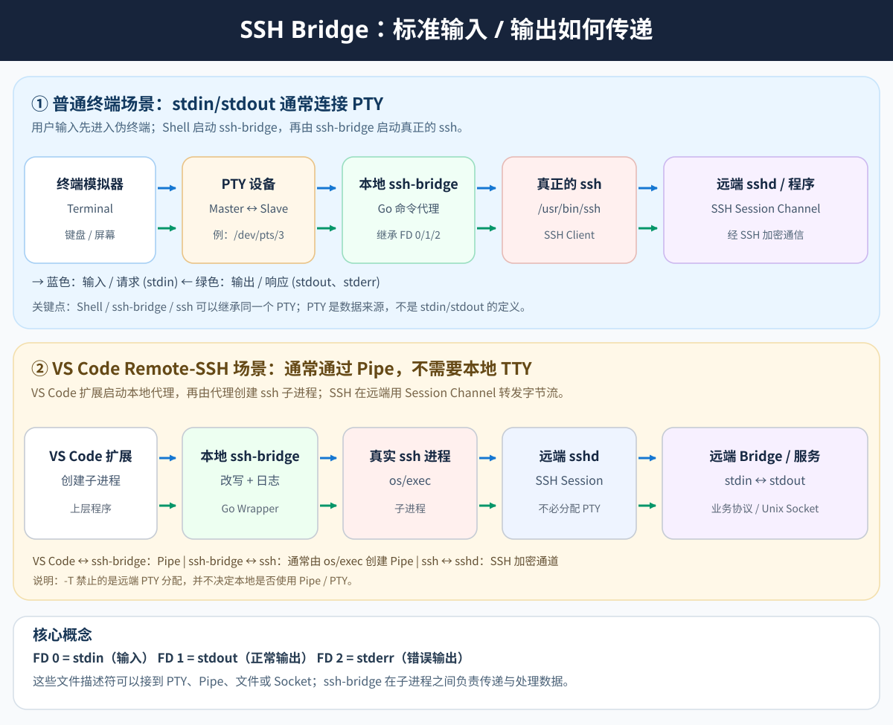
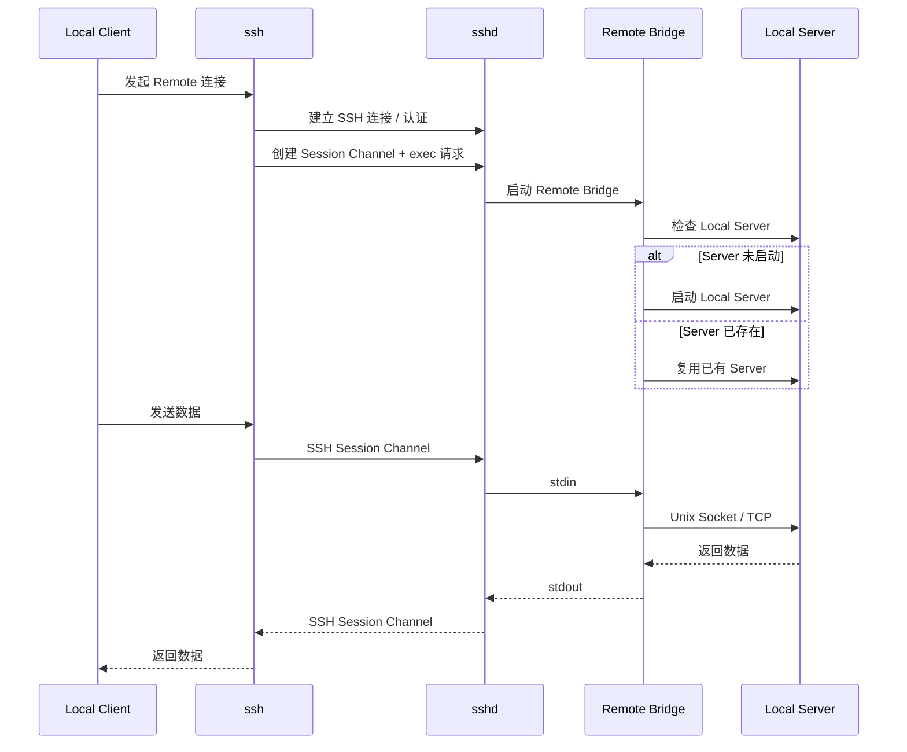

# SSH Bridge 原理说明：stdin/stdout、TTY/PTY、Pipe 与 Session Channel

> **一句话理解**：SSH Bridge 并不一定是 SSH 协议本身的实现。它可以是一个**本地命令代理（Wrapper）**：启动真正的 `ssh` 子进程，把上层程序的标准输入传给它，再将它的标准输出、标准错误返回给上层；也可以是一个**远端业务 Bridge**：由 `sshd` 启动，从 SSH Session Channel 接收数据，再转发给实际服务。

## 1. 总览：普通终端与 VS Code Remote-SSH



[单独打开原理图](./images/ssh-bridge-stdio.svg)

这张图要说明三个概念：

1. **stdin / stdout / stderr** 是进程使用的标准文件描述符（FD 0 / 1 / 2），不是一种叫作 TTY 的专用数据通道。
2. **TTY/PTY 或 Pipe** 决定标准文件描述符实际连接到哪里。交互式终端通常连接 PTY；VS Code 扩展启动的 SSH 通常通过 Pipe 通信。
3. **ssh-bridge 与真正的 ssh 是两个进程**。本地 Wrapper 在二者之间传递数据；真正的 SSH 再通过加密的 Session Channel 与远端 `sshd` 通信。

> **特别区分**：图中的“本地 ssh-bridge（Go Wrapper）”和后面示例中的“远端 Remote Bridge”可以同时存在，但不是同一个程序，也不承担同样的职责。

## 2. 标准输入 / 输出从哪里来？

Linux/macOS 进程通常使用以下约定：

| 文件描述符 | 名称 | 方向 | 可能连接的对象 |
| --- | --- | --- | --- |
| `0` | `stdin` | 输入 | PTY、Pipe、文件、Socket |
| `1` | `stdout` | 正常输出 | PTY、Pipe、文件、Socket |
| `2` | `stderr` | 错误输出 | PTY、Pipe、文件、Socket |

文件描述符通常由父进程在启动子进程时设置或传递；子进程继承这些文件描述符（也可能被重定向）。因此，**标准输入输出不一定来自 TTY**。

### 2.1 普通终端：通常经过 PTY

在 Terminal 中执行：

```bash
ssh user@server
# 或：ssh-bridge user@server
```

可以将数据链路理解为：

```text
键盘 / Terminal 终端模拟器
      ↕ PTY Master
内核 PTY 设备
      ↕ PTY Slave（如 /dev/pts/3）
Shell → [本地 ssh-bridge] → /usr/bin/ssh
                               ↕ SSH 加密连接
                            远端 sshd
```

- Terminal 终端模拟器操作 PTY Master；Shell 的 stdin/stdout/stderr 通常连接 PTY Slave。
- Shell 启动程序时，程序通常继承这些描述符。
- 若中间加入本地 `ssh-bridge`，它仍可读取 stdin，并把子进程的 stdout/stderr 写回同一终端。
- **本地使用 PTY**与**远端是否申请 PTY**是两回事。

### 2.2 VS Code Remote-SSH：通常通过 Pipe

VS Code Remote-SSH 扩展是启动命令的上层进程，典型链路如下：

```text
VS Code Remote-SSH 扩展进程
    ├── 写入 Pipe ──→ ssh-bridge 的 stdin（FD 0）
    ├── 读取 Pipe ←── ssh-bridge 的 stdout（FD 1）
    └── 读取 Pipe ←── ssh-bridge 的 stderr（FD 2）
                              │
                    Go 代理 / os/exec
                              │
                真正的 /usr/bin/ssh
                              │
                      SSH Session Channel
                              │
                          远端 sshd
```

此时 VS Code 可以直接向 Pipe 写安装脚本、控制消息等字节；Bridge 接收后送入 SSH 子进程，SSH 的输出经 Bridge 返回 VS Code。**整个本地过程不要求存在 TTY。**

## 3. 本地 ssh-bridge：为什么说它是“命令代理”？

忽略额外的日志、改写与端口转发逻辑，Go Wrapper 可以缩减成：

```go
package main

import (
    "os"
    "os/exec"
)

func main() {
    cmd := exec.Command("/usr/bin/ssh", os.Args[1:]...)

    cmd.Stdin = os.Stdin   // 把代理程序的输入交给 ssh
    cmd.Stdout = os.Stdout // 把 ssh 的输出返回给调用方
    cmd.Stderr = os.Stderr // 把 ssh 的错误返回给调用方

    if err := cmd.Run(); err != nil {
        os.Exit(1)
    }
}
```

它没有实现 SSH 认证、加密或 Session Channel；这些仍由真正的 `ssh` 负责。Wrapper 做的是**进程启动、参数代理与数据流连接**。

### 3.1 原始 Go 代码多做了哪些处理？

在当前 `ssh-bridge` Go 实现中：

- 读取 `os.Args[1:]`，调用 `exec.Command(realSSH, sshArgs...)` 启动真正的 SSH。
- 使用 `rewriteReader` 改写输入流：删除 `--no-config`；将 `--host=127.0.0.1` 改为 `--host=0.0.0.0`。
- 使用 `io.TeeReader` 把**改写后的 stdin**一边送给 SSH，一边复制到日志。
- 使用 `fanoutWriter` 将 SSH 的 stdout/stderr 同时写回上层进程和 `stdout.log`。
- 对可解析的 `-L` 参数，移除原本的 SSH 本地转发，改用直接连接目标 IP/端口的 TCP Proxy。

所以实际数据流是：

```text
VS Code → Bridge stdin → rewriteReader → io.TeeReader → ssh stdin
                                    └───────────────→ 日志

ssh stdout → fanoutWriter → Bridge stdout → VS Code
                         └→ stdout.log

ssh stderr → fanoutWriter → Bridge stderr → VS Code
                         └→ stdout.log
```

**实现细节**：若 `cmd.Stdin = os.Stdin`、`cmd.Stdout = os.Stdout`，且两者是 `*os.File`，Go 通常可以直接传递相应的文件描述符。若使用 `io.TeeReader`、`fanoutWriter` 这样的自定义 Reader/Writer，`os/exec` 通常会建立 Pipe 并通过复制 goroutine 传输数据，而不只是“把 FD 直接绑定上去”。

**边界与安全提示**：

- `-L` 替换成普通 TCP 代理**不等价于 SSH 隧道**，直连数据不再由 SSH 自动加密，且要求本机网络能直接访问目标服务。
- 把远端服务监听地址从 `127.0.0.1` 改为 `0.0.0.0` 可能扩大服务暴露范围；需要网络访问控制。
- 记录 stdin/stdout 可能泄漏敏感脚本、服务令牌或业务数据；输出到上层的 stdout 不能混入调试日志，否则可能破坏 VS Code 的协议解析。

## 4. 远端 Bridge：SSH Session Channel 转发业务数据

原文档的这个示例描述的是**远端 Bridge**，并不是上一节的本地 Go Wrapper：

```bash
ssh -T devbox 'exec /home/work/.local/bin/herdr remote-client-bridge'
```

它的核心思想是：

> 使用 SSH Session Channel 作为双向字节流，`sshd` 在远端启动 Bridge 进程，并把客户端数据与 Bridge 的 stdin/stdout 相互转发。

### 4.1 整体链路（保留原有远端 Bridge 工作方式）



若启用了本地 Wrapper，只需要把它插入 `Client` 和 `SSH` 之间；远端 `sshd` 与 Remote Bridge 的机制并不改变。

### 4.2 sshd 做了什么？

SSH 不仅能远程登录，还能**启动远端程序，并通过加密连接双向转发其输入输出**：

1. SSH Client 与 `sshd` 建立加密连接，完成认证。
2. 客户端打开 Session Channel，按需申请 PTY，并发送远端执行命令的请求。
3. `sshd` 启动程序，将 Channel 收到的数据送入程序，将程序的输出传回客户端。

远端 Bridge 可以检查实际业务服务是否启动：未启动则启动，已启动则复用；再通过 Unix Socket 或 TCP 连接服务。**这部分是业务 Bridge 的工作，不是 sshd 自动完成的。**

## 5. `-t`、`-T`：控制远端 PTY，不是本地 stdin/stdout

### 5.1 `-t`：带远端 PTY，适合交互式程序

```bash
ssh -t devbox 'vim /tmp/123.txt'
```

`-t` 请求远端 PTY。远端 `sshd` 读写 PTY 主端，Vim 的 stdin/stdout/stderr 连接 PTY 从端。

PTY 提供回显、终端尺寸、输入模式和控制字符转信号等终端能力；颜色、光标移动等输出由本地终端模拟器显示。

### 5.2 `-T`：禁止远端 PTY，适合服务通信

```bash
ssh -T devbox 'my-service --stdio'
```

远端服务启动后：

- 本地 SSH 的 `stdin` → SSH Session Channel → 服务的 `stdin`。
- 服务的 `stdout` → Session Channel → 本地 SSH 的 `stdout`。
- 服务的 `stderr` 通过 SSH 通道的独立错误数据流返回本地 `stderr`（正常的非 PTY 执行场景）。

不经过远端 PTY，可以避免回显、换行转换等对协议数据的干扰，适合服务协议与二进制数据。服务需要自行支持从 stdin 读取请求、向 stdout 写入响应。

使用 `-T` 启动 Vim 等交互程序时，它可能无法正常交互。**原因是缺少终端环境，而非 SSH 无法传输控制字符。**

| 比较项 | `ssh -t` | `ssh -T` |
| --- | --- | --- |
| 远端是否申请 PTY | 是 | 否 |
| 远端程序的标准输入输出 | 通常连接 PTY Slave | 通常连接 Pipe |
| 更适合 | Vim、Shell 等交互式程序 | 远程脚本、stdio 协议、服务通信 |
| 是否决定本地使用 TTY | 否 | 否 |

## 6. 怎样验证本地 stdin/stdout 是 PTY 还是 Pipe？

在 Linux 交互式 Shell 中执行：

```bash
tty
ls -l /proc/$$/fd/{0,1,2}
test -t 0 && echo "stdin 是 TTY" || echo "stdin 不是 TTY"
test -t 1 && echo "stdout 是 TTY" || echo "stdout 不是 TTY"
```

例如，`/dev/pts/3` 表示伪终端，`pipe:[123456]` 表示管道。如果在 macOS，可以使用：

```bash
tty
lsof -a -p $$ -d 0,1,2
```

**注意**：`tty` / `test -t` 判断的是当前命令所继承的终端环境；要检查 VS Code 启动的 Bridge，应针对那个进程的 FD 检查，不能用自己打开的 Terminal 环境代替。

## 7. 最后总结

完整逻辑可以拆成两层：

1. **进程 I/O 层**：上层应用或终端为本地 Bridge 提供 stdin/stdout/stderr；本地 Wrapper 通过 `os/exec` 启动真正的 SSH，并把输入输出连接、改写或记录。它们可以通过 PTY 或 Pipe 传输。
2. **SSH 与远端业务层**：SSH Client 和 `sshd` 建立加密的 Session Channel；`sshd` 启动远端 Bridge，远端 Bridge 通过 Unix Socket/TCP 与实际服务交换字节。

`sshd` 负责认证、启动远程程序和转发 SSH 字节流；Bridge 负责连接或代理业务服务。SSH 不处理业务消息边界，请求分帧、响应匹配通常由应用层协议实现。

**最重要的一句话：stdin/stdout 是进程的标准文件描述符，TTY/PTY 和 Pipe 是承载它们的不同方式；本地 ssh-bridge 是命令代理，真正的 ssh/sshd 才负责 SSH 协议通信。**
