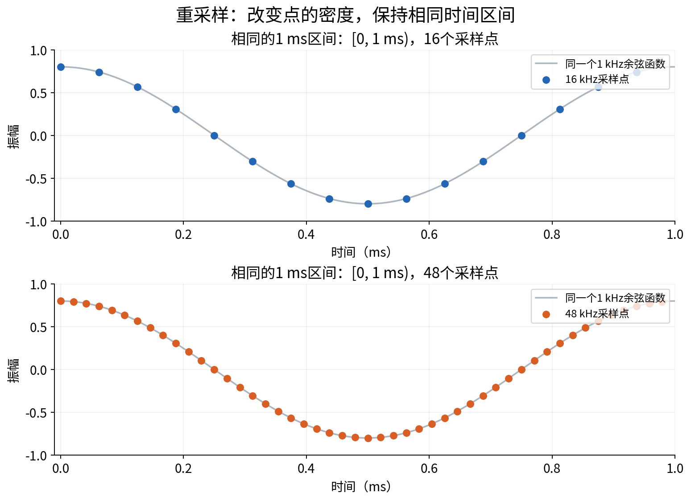
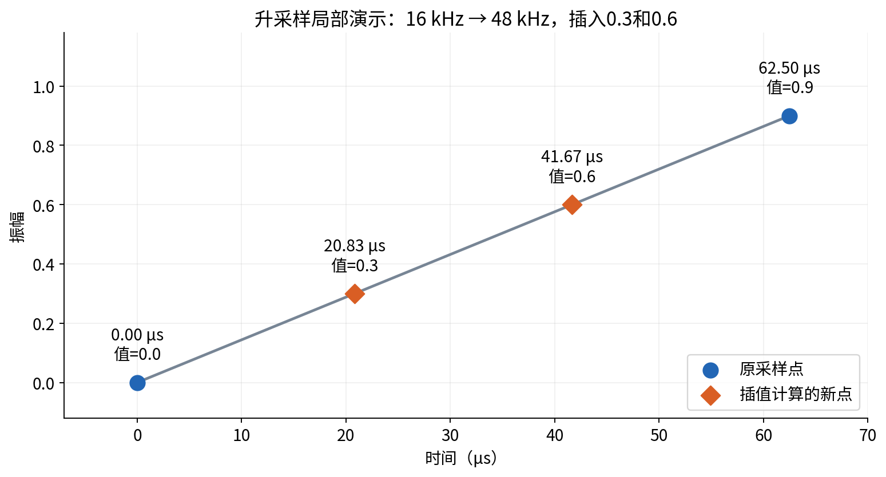
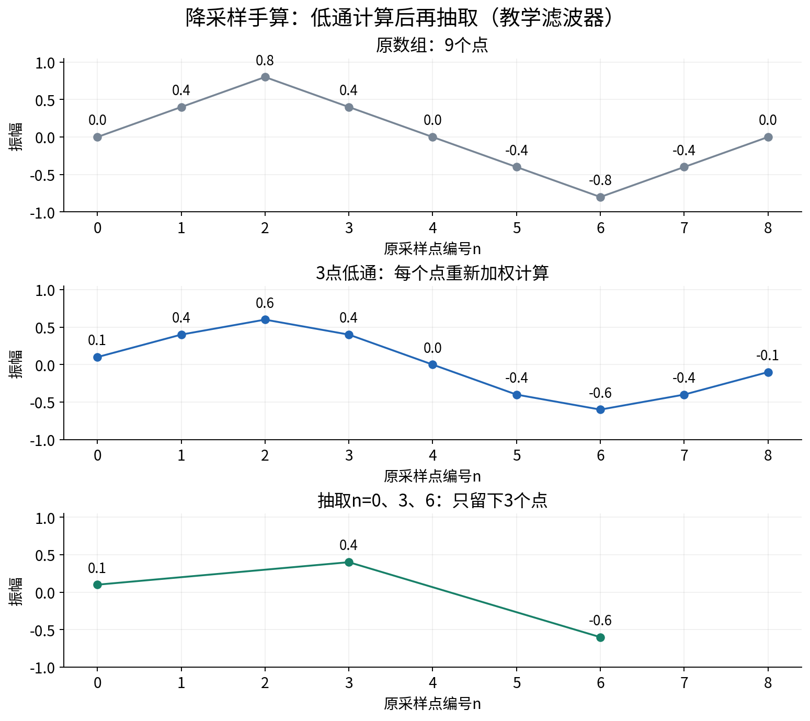
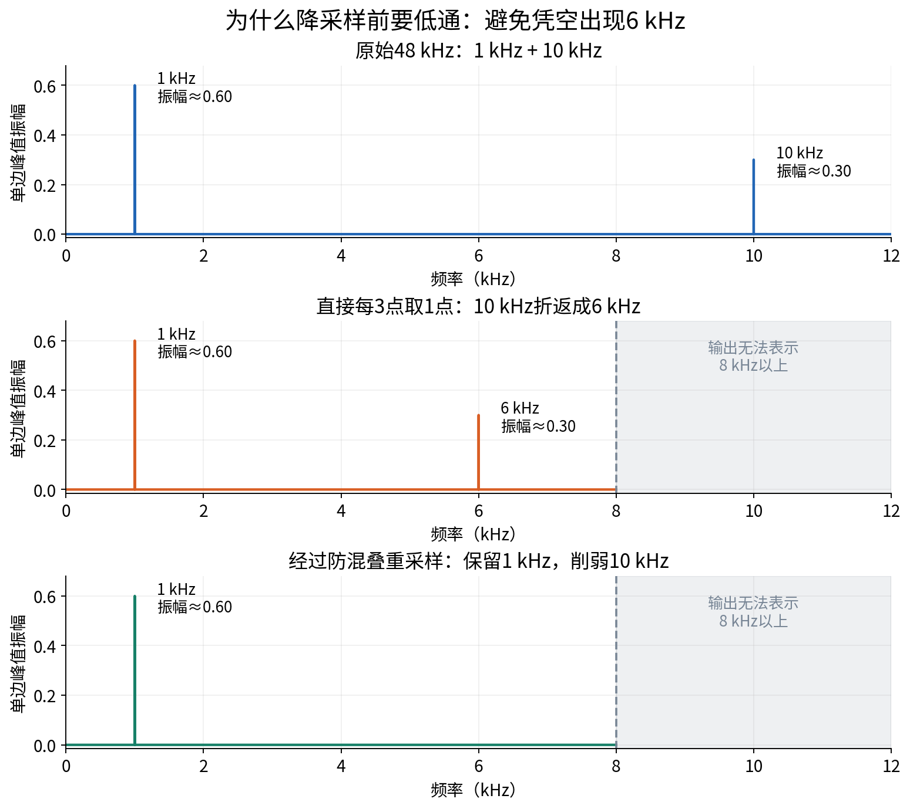
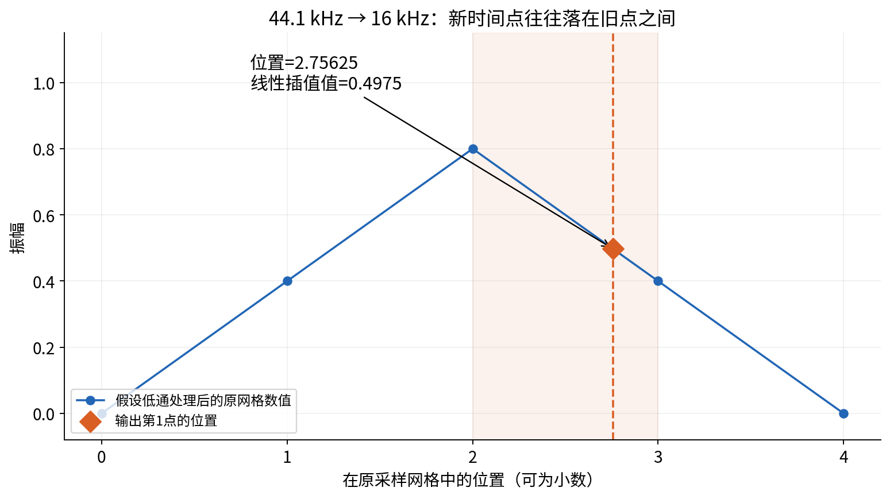
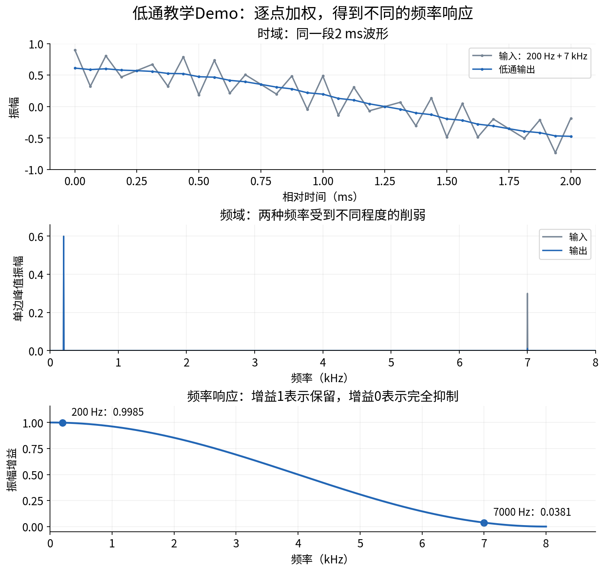
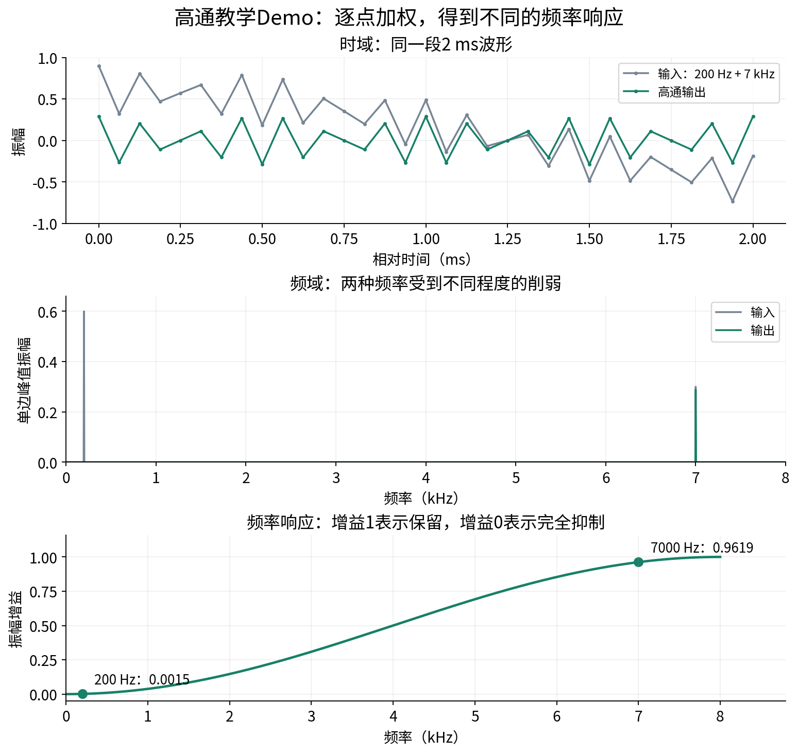
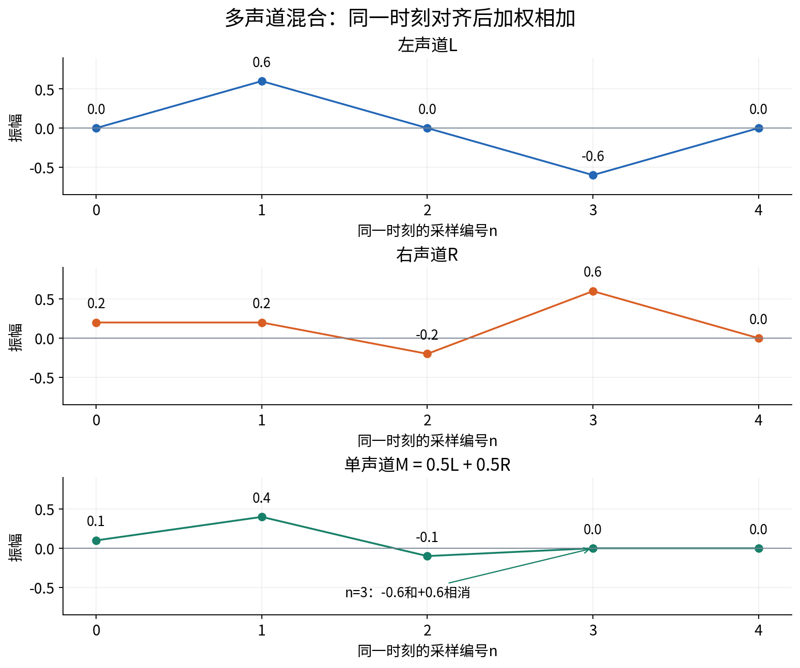

# 音频重采样、滤波与多声道混合：看图、手算、跑 Demo

这份笔记回答六个问题：重采样是什么；升采样如何插值；降采样是否也需要插值；低通、高通如何逐点计算；多声道如何合成一路。

**先记住：PCM 是按时间排列的一串振幅值。重采样改变时间网格，滤波改变频率成分，混音把同一时刻的多个声道加权相加。**

[打开可放大图片的图文阅读版](audio-resampling-reader.html) · [下载 Python Demo](audio-resampling-assets/audio_demo.py)

所有图由配套 Python 程序按公式计算生成。图中的连线帮助观察，真正的 PCM 数据是离散采样点。为便于手算，例子大多使用归一化浮点振幅；16 位有符号 PCM 的整数范围是 −32768～32767。

## 1. 重采样：换一套记录时间点

### 通俗理解

原来每秒记录 16000 个振幅值，现在每秒记录 48000 个。记录更密了，但描述的仍然是相同时间内的声音。

升采样和降采样都是重采样。一般音频转换要保持时长，以及保留下来的声音成分的音调。

### Demo 计算：同一秒，点数不同

```text
采样间隔 Δt = 1 / 采样率
采样点数 N = 时长 × 采样率

16 kHz：Δt = 1/16000 秒 = 62.5 μs
48 kHz：Δt = 1/48000 秒 ≈ 20.8333 μs

1 秒音频：16000 点 → 48000 点
时长核对：16000/16000 = 48000/48000 = 1 秒
```

这里的“点数”是每个声道的点数。双声道一秒有 16000 个采样帧，每帧包含左右两个值，共 32000 个数值。



**读图：**两行都是同一个 1 kHz 余弦函数；横轴范围一样，48 kHz 的点更密。这里画已知函数是为了说明时间网格；处理录音时，算法只有旧采样值，需要估计新时间点的值。

注意，1 秒的离散点通常位于 `[0, 1秒)`：第一个点在 0，最后一个在 `1−1/fs`。文件时长按 `N/fs` 计算，不是按第一点与最后一点的距离计算。

### 一个常见误区

把 16000 个点原封不动标记成 48 kHz，播放时长会变为 `16000/48000 = 1/3 秒`，播放速度和音调都会改变。这是修改播放解释方式，没有完成重采样。

## 2. 升采样：是的，计算新点叫插值

### 通俗理解

已知两个时间点的振幅，估计它们中间某个时间的振幅，就叫插值。最容易理解的是连接两个点，沿直线取值。

### Demo 计算：16 kHz → 48 kHz

取相邻的两个旧点：

| 时间 | 旧振幅 |
|---|---:|
| 0 μs | 0.0 |
| 62.5 μs | 0.9 |

升到 48 kHz 后，间隔变为约 20.8333 μs，因此中间增加两个点：

```text
新值 = 左端值 × (1−比例) + 右端值 × 比例

第1个新点：比例 = 1/3
值 = 0×(2/3) + 0.9×(1/3) = 0.3

第2个新点：比例 = 2/3
值 = 0×(1/3) + 0.9×(2/3) = 0.6

局部序列：0.0 → 0.3 → 0.6 → 0.9
```



**读图：**蓝色是已有点，橙色是估计的新点。这个局部例子包含两端点，不能用它的“2点变4点”推断整个文件的倍率；整个文件的点数仍按时长与采样率计算。

### 实际音频里怎么做

线性插值适合入门。音频处理中常用带限插值，例如基于 sinc 的有限长度 FIR 近似。整数倍升采样在数学上也可以表示为“插零，再用插值低通滤波器计算”；插零只是中间步骤，输出不会保持那些零值。[1]

SciPy 的 `resample_poly` 使用升采样、低通 FIR、降采样这一多速率处理框架。[1]

```python
from scipy.signal import resample_poly
y_48k = resample_poly(x_16k, up=3, down=1)
```

**增加点数不会恢复原录音中已经丢失的细节。** 它让同一份信号适配另一套采样网格。

## 3. 降采样：先防混叠，再减少点数

### 通俗理解

点少了，能准确描述的最高频率也降低了。把 48 kHz 降到 16 kHz，输出奈奎斯特频率是 `16000/2 = 8000 Hz`。在抽点前，需要充分削弱输出无法表示的高频。

工程滤波器不是一把在 8 kHz 处瞬间切断的刀，需要过渡带与足够的阻带衰减。下面的三点低通只用于手算，不能承担合格的 48 kHz → 16 kHz 防混叠任务。[1][2]

### Demo A：逐点计算，再每3点取1点

用一个方便手算的中心对齐低通：

```text
z[n] = 0.25x[n−1] + 0.5x[n] + 0.25x[n+1]
y[m] = z[3m]
```

`x` 是原数据，`z` 是滤波结果，`y` 是降采样结果。假设输入是：

```text
n：  0    1    2    3    4     5     6     7    8
x：0.0  0.4  0.8  0.4  0.0  −0.4  −0.8  −0.4  0.0
```

边界以 0 补齐，选择 `n=0、3、6`：

| 保留位置 | 先计算滤波值 | 输出 |
|---|---|---:|
| n=0 | 0.25×0 + 0.5×0 + 0.25×0.4 | 0.1 |
| n=3 | 0.25×0.8 + 0.5×0.4 + 0.25×0 | 0.4 |
| n=6 | 0.25×(−0.4) + 0.5×(−0.8) + 0.25×(−0.4) | −0.6 |

得到 `[0.1, 0.4, −0.6]`。若直接抽原数据，会得到 `[0.0, 0.4, −0.8]`。



**读图：**先重新计算各点的振幅，再只保留三个时间位置。整数倍抽取不一定需要在两个时间点之间插值，但滤波依然涉及计算。

这套中心对齐公式用到了未来点 `x[n+1]`，适合离线教学。实时实现需要等待一个采样间隔，或改成具有延迟的因果实现。

### Demo B：为什么不能直接删点

构造一段 48 kHz 音频：

```text
x(t) = 0.6cos(2π×1000×t) + 0.3cos(2π×10000×t)
```

它包含 1 kHz 和 10 kHz。直接每3点取1点后，新采样率是 16 kHz。对其中的 10 kHz 分量，在新采样位置有：

```text
cos(2π×10000×m/16000)
= cos(2πm − 2π×6000×m/16000)
= cos(2π×6000×m/16000)
```

**新采样点无法区分这个10 kHz余弦与6 kHz余弦，频谱中出现6 kHz，这就是混叠。** 它不是把原来的10 kHz正确保留下来了。



**读图：**第一行原频谱有 1 kHz、10 kHz；第二行直接抽取变成 1 kHz、6 kHz；第三行通过真实 FIR 重采样，保留 1 kHz，先削弱原来的 10 kHz，避免明显折返。

这里纵轴是正弦分量的**峰值振幅**，不是功率，也不是响度。图来自中间1秒的数据，避开起止边界瞬态。

配套程序的实际输出如下。有限长度滤波器仍有很小的残留，不是数学上的绝对清零：

| 输出中的频率 | 直接抽点 | 防混叠重采样 |
|---|---:|---:|
| 1 kHz | 0.600000 | 0.600004 |
| 6 kHz混叠 | 0.300000 | 0.000258 |

```python
# 实际处理方式：内部包含防混叠低通
y_16k = resample_poly(x_48k, up=1, down=3,
                      window=('kaiser', 8.6))
```

### Demo C：44.1 kHz → 16 kHz，也需要插值吗

**通常需要，因为新时间点大多不与旧时间点对齐。**

```text
新第m点的时间：t = m / 16000
它在旧网格的位置：位置 = t × 44100 = m × 2.75625

m=0：位置0
m=1：位置2.75625，落在旧第2点和第3点之间
m=2：位置5.5125
```

假设低通处理后的第2、3点分别是 0.8 和 0.4，用线性插值演示位置2.75625的计算：

```text
比例 = 2.75625−2 = 0.75625
新值 = 0.8×0.24375 + 0.4×0.75625 = 0.4975
```



**读图：**橙点位于旧第2、3点之间。线性公式只解释新点的位置与估算方法；实际转换使用合适的带限滤波插值，而不是“先随便插值，再等混叠出现”。

```text
16000/44100 = 160/441
理论结构：升采样160倍 → 低通滤波 → 降采样441倍
```

多相实现会跳过无用计算，不必真的保存一份160倍大的中间数组。[1]

```python
y_16k = resample_poly(x_44100, up=160, down=441)
# 本实验：4410点/44100 Hz = 1600点/16000 Hz = 0.1秒
```

## 4. 低通滤波：保留慢变化，削弱快变化

### 通俗理解

“低通”的低，指低频。低频成分随时间变化较慢，高频成分变化较快。它并不是保留小音量、删除大音量。

数字滤波器通过当前点及邻近点的加权计算，让不同频率受到不同的增益。许多实现直接处理 PCM 数组，不需要先做 FFT。FFT 可以帮助查看它改变了哪些频率成分。

### Demo 计算：三个点如何得到一个输出点

继续使用三点低通：

```text
低通[n] = 0.25x[n−1] + 0.5x[n] + 0.25x[n+1]

输入局部序列：[0.2, 0.8, 0.2, 0.8, 0.2]

n=1：0.25×0.2 + 0.5×0.8 + 0.25×0.2 = 0.5
n=2：0.25×0.8 + 0.5×0.2 + 0.25×0.8 = 0.5
n=3：0.25×0.2 + 0.5×0.8 + 0.25×0.2 = 0.5
```

本例把快速交替的波动压掉，留下中间三个输出点 `[0.5, 0.5, 0.5]`。边界没有参与这项手算。

### 为什么同一公式能区分高低频

对于常量 `[0.5,0.5,0.5,…]`，输出仍是 0.5；对于逐点交替的 `[1,−1,1,−1,…]`，内部输出变为 0。一个变化最慢，一个变化最快，结果明显不同。

这套中心对齐滤波器的振幅增益是：

```text
低通增益 G(f) = cos²(πf/fs)
输出分量振幅 = 输入分量振幅 × G(f)
```

该公式由本例三项加权直接推导。`fs=16000 Hz` 时：

| 分量 | 输入振幅 | 低通增益 | 输出振幅约 |
|---|---:|---:|---:|
| 200 Hz | 0.6 | 0.998459 | 0.5991 |
| 7000 Hz | 0.3 | 0.038060 | 0.0114 |



**读图：**灰线是输入，蓝线是输出；200 Hz 几乎保留，7 kHz 明显削弱。第三行显示其逐渐变化的频率响应，而不是某个频率之后全部瞬间归零。

简单平均或短加权平均可以说明平滑原理，但频带分离能力有限。实际截止频率、过渡带和抑制程度，需要专门设计滤波器。[2]

## 5. 高通滤波：削弱慢变化，保留快变化

### 通俗理解

“高通”的高，指高频。常见用途是去除直流偏置、削弱低频轰鸣。它也会削弱同一频段内的有用声音，不能自动判断哪部分是噪声。

### Demo 计算：原值减去对齐的低通结果

对上面这套中心对齐低通，可以构造互补高通：[3]

```text
高通[n] = x[n] − 低通[n]
        = −0.25x[n−1] + 0.5x[n] − 0.25x[n+1]
```

沿用输入 `[0.2, 0.8, 0.2, 0.8, 0.2]`：

| n | 输入x[n] | 低通结果 | 高通=x−低通 |
|---|---:|---:|---:|
| 1 | 0.8 | 0.5 | 0.3 |
| 2 | 0.2 | 0.5 | −0.3 |
| 3 | 0.8 | 0.5 | 0.3 |

低通留下平滑部分，高通留下围绕平滑部分的快速波动。在本例中，两个结果相加能恢复原值。

**“原信号减低通”成立的前提是时间与相位对齐。** 如果实际低通有延迟，应把原信号延迟到同一时间位置再相减，不能直接逐点相减不同时间的数据。也不是任意低通相减都会得到理想高通。

### 高频为什么更容易通过

对于这套教学滤波器：

```text
高通增益 G(f) = 1 − cos²(πf/fs) = sin²(πf/fs)
```

| 分量 | 输入振幅 | 高通增益 | 输出振幅约 |
|---|---:|---:|---:|
| 200 Hz | 0.6 | 0.001541 | 0.0009 |
| 7000 Hz | 0.3 | 0.961940 | 0.2886 |



**读图：**200 Hz 明显削弱，7 kHz 大部分保留。对常量输入，三个系数之和为0，内部输出为0，这就是去除直流成分。

## 6. 多声道混合：同一时间的值加权相加

### 通俗理解

左右声道分别是一串 PCM 值。双声道变单声道，最直接的方式是对同一时刻的两个值求平均。FFmpeg 的 `pan` 支持明确指定各输入声道的混合权重。[4]

```text
M[n] = 0.5L[n] + 0.5R[n]
```

它与滤波的关键区别是：这里从**不同声道、同一时间**取值；前面的滤波从**同一声道、邻近时间**取值。

### Demo 计算：五个采样时刻

| n | 左L | 右R | M=0.5L+0.5R |
|---|---:|---:|---:|
| 0 | 0.0 | 0.2 | 0.1 |
| 1 | 0.6 | 0.2 | 0.4 |
| 2 | 0.0 | −0.2 | −0.1 |
| 3 | −0.6 | 0.6 | 0.0 |
| 4 | 0.0 | 0.0 | 0.0 |



**读图：**第3号点左右相反，平均后为0。混合不一定变响，声道间的相位与延迟会影响结果。

权重也可以换成 `M=0.8L+0.2R`：第1号点变为 `0.8×0.6+0.2×0.2=0.52`，左声道贡献更大。

### 为什么需要权重与足够宽的中间类型

若直接相加 `0.8+0.7=1.5`，写入通常以约 `[-1,1]` 表示的 PCM 范围时会削波。各乘0.5，得到0.75。

对16位PCM，`30000+30000=60000` 已超过 int16 范围。先转换成 float 或 int32，再相加并除以2，最后转换回 int16。不要先用 int16 相加让它溢出。

```python
mono_float = stereo_int16.astype('float64').mean(axis=1)
mono_int16 = mono_float.round().clip(-32768, 32767).astype('int16')
```

对于麦克风阵列，简单平均不等于波束形成；波束形成通常还需要方向对应的延迟、权重或更复杂处理。带有扬声器参考声道的多通道录音，也要先确认每一路的用途，再决定混哪些通道。

## 7. 六个概念放在一起

| 处理 | 主要改变 | 点数/声道数 | 核心计算 |
|---|---|---|---|
| 重采样 | 采样时间网格 | 每声道点数变化 | 在新时间网格计算值 |
| 升采样 | 点更密 | 点数增加 | 插值，常结合低通 |
| 降采样 | 点更稀 | 点数减少 | 防混叠低通，再抽取/插值 |
| 低通 | 削弱高频成分 | 通常保持点数、声道数 | 邻近时间点加权 |
| 高通 | 削弱低频成分 | 通常保持点数、声道数 | 邻近时间点加权 |
| 多声道混合 | 合成声道内容 | 可减少声道数 | 同一时间、不同声道加权 |

表中滤波保持点数，指按同长度输出的常见处理约定。卷积也可选择输出完整尾部或仅输出有效区间，因此代码里的长度还取决于边界处理方式。

## 8. 动手运行与实际音频转换

### 运行配套实验

文件 [audio_demo.py](audio-resampling-assets/audio_demo.py) 会生成全部8张图和 `calculation_results.json`，并核对插值、滤波、混音、混叠以及转换点数。

```bash
python3 -m pip install numpy scipy matplotlib
python3 audio-resampling-assets/audio_demo.py --out demo_output

# 如系统没有中文字体，指定已有中文字体的完整路径：
python3 audio-resampling-assets/audio_demo.py --out demo_output --font /path/to/NotoSansCJKsc-Regular.otf
```

实验里的三点低通/高通与防混叠 FIR 是两种不同用途：前者便于手算，后者演示实际降采样。没有中文字体时计算依然可以运行，但图片中文字可能无法正常显示。

### 用FFmpeg处理自己的音频

把普通双声道音频明确按左右各0.5混合，再重采样成16 kHz、16位、单声道WAV：[4]

```bash
ffmpeg -i input_stereo.wav \
  -af "pan=mono|c0=0.5*c0+0.5*c1,aresample=16000" \
  -c:a pcm_s16le output_16k_mono.wav
```

这个命令用 `pan` 明确规定混合公式，用 `aresample` 执行重采样。它输出带文件头的 WAV，内部编码是16位小端有符号 PCM。输入若为多麦克风及参考信号，应先按通道用途选择与映射，不能把所有声道直接平均。

## 9. 查证来源

查阅日期：2026-10-14。概念与工具行为参考以下原始教材、官方文档；数组、图示和手算例子由配套程序独立构造。

1. [SciPy 官方：resample_poly](https://docs.scipy.org/doc/scipy/reference/generated/scipy.signal.resample_poly.html) — 升采样、低通FIR、降采样的处理结构与多相实现。
2. [Steven W. Smith《DSP Guide》第15章](https://www.dspguide.com/CH15.PDF) — 平均滤波的逐点计算、平滑作用与频率选择性的限制。
3. [Steven W. Smith《DSP Guide》第14章](https://www.dspguide.com/CH14.PDF) — 频率响应、低通转高通的谱反转方法与对齐条件。
4. [FFmpeg 官方：Filters](https://ffmpeg.org/ffmpeg-filters.html#pan) — `pan`声道权重混合；同页的[aresample](https://ffmpeg.org/ffmpeg-filters.html#aresample)说明实际重采样。
