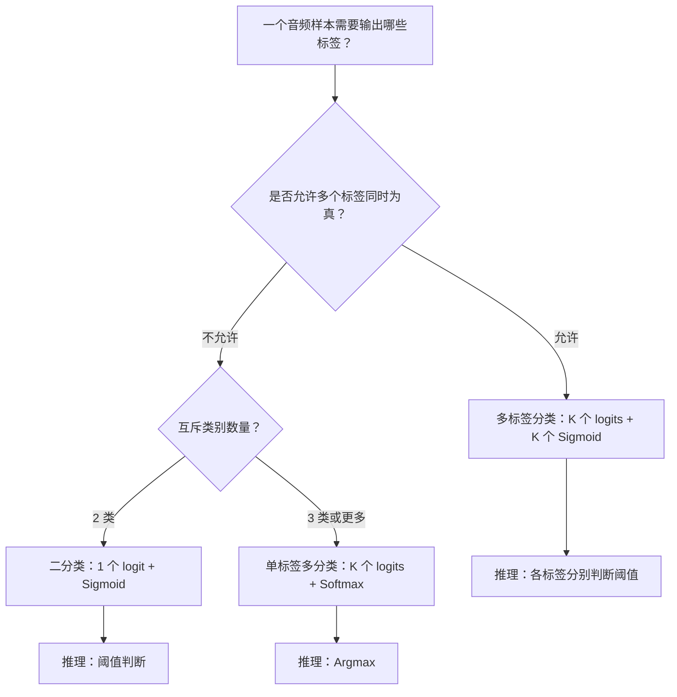
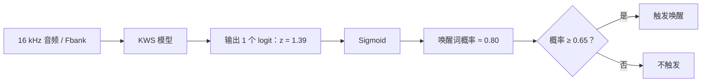
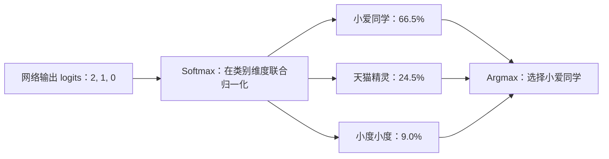
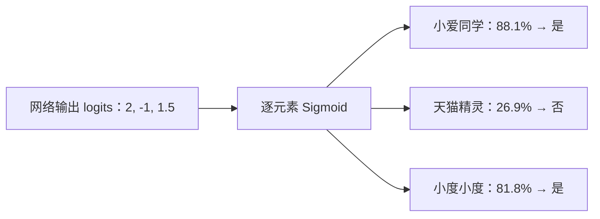
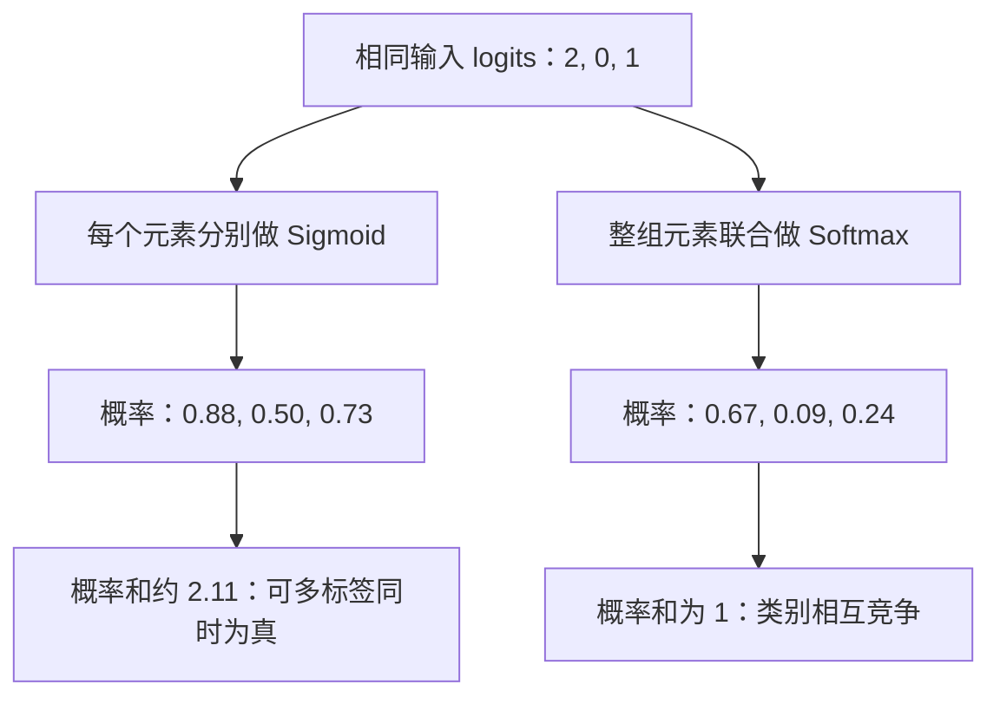
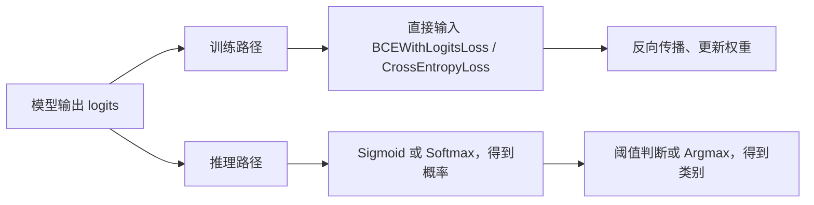

# 分类任务的激活函数与损失函数

> **一句话总结**
> **二分类 → 1 个 Sigmoid；单标签多分类 → 1 组 Softmax；多标签分类 → 每个标签各用 1 个 Sigmoid。**
> 在 PyTorch 中，训练时通常把**原始 logits**直接交给配套的损失函数，不需要在模型输出后手动调用 Sigmoid / Softmax。

## 1. 三种分类任务总览

| 任务类型 | 每个样本的正确标签 | 模型输出 | 推理时概率转换 | 典型损失函数（PyTorch） | 决策方式 |
| --- | --- | --- | --- | --- | --- |
| 二分类（Binary） | 0 或 1 | 1 个 logit（常见） | `sigmoid` | `BCEWithLogitsLoss` | 概率与阈值比较 |
| 单标签多分类（Multiclass / Single-label） | K 类中恰好 1 类 | K 个 logits | `softmax(dim=-1)` | `CrossEntropyLoss` | `argmax` 选择最大分值 |
| 多标签分类（Multilabel） | K 个标签各自为 0/1，可以同时成立 | K 个 logits | 对每个 logit 用 `sigmoid` | `BCEWithLogitsLoss` | 每个标签各自与阈值比较 |

**注意：**二分类还可以用「2 个 logits + Softmax + CrossEntropyLoss」实现，并不强制只有 Sigmoid 一种实现；表中是最常见的建模方式。

### 图 1：先判断“标签能否同时成立”



> 上图展示**常用输出层方案**，不是唯一实现：二分类也可以使用 `2 logits + Softmax`。

## 2. 二分类（Binary Classification）

**问题：**是否检测到“你好小智”？

- 标签：`y ∈ {0, 1}`，其中 1 表示唤醒词出现，0 表示未出现。
- 网络输出：一个**原始分数** `z ∈ ℝ`（称为 logit）。
- 推理转换：`p = sigmoid(z) = 1 / (1 + exp(-z))`，`p` 在 `[0, 1]`。
- 决策：若 `p ≥ threshold`，判定正类。默认阈值常设为 `0.5`，真实 KWS 系统需要根据误唤醒率（FAR）和漏唤醒率（FRR）调优。
- 训练：`BCEWithLogitsLoss(z, y)`，内部已包含数值稳定的 Sigmoid 与二元交叉熵计算。

**变体：**若用两个 logits `z0, z1` 加 Softmax，那么正类概率为 `softmax([z0,z1])[1] = sigmoid(z1 - z0)`。因此两类 Softmax 与一输出 Sigmoid 可以表达等价的二分类概率。

### 图 2：二分类的数据流（唤醒词检测）



图中的 `0.65` 是演示用阈值，不是通用的 KWS 推荐阈值；实际阈值需通过 FAR/FRR 评测确定。

## 3. 单标签多分类（Multiclass Classification）

**问题：**一段音频只能判为一个类别：`其他`、`小爱同学`、`天猫精灵` 或 `小度小度`。

- 网络输出：`K` 个 logits，即 `[z1, z2, ..., zK]`。
- 推理转换：`p_i = exp(z_i) / Σ_j exp(z_j)`，即 Softmax。
- 特征：每类概率非负，且 **Σ p_i = 1**，表示类别之间互斥竞争。
- 决策：取 `argmax(logits)`；不必先算 Softmax，argmax 结果相同。
- 训练：`CrossEntropyLoss(logits, target_class_index)`。PyTorch 的交叉熵损失直接接收 logits，内部做 `log_softmax`；**不要先手动做 Softmax 再交给 CrossEntropyLoss**。

> **举例**
> 预测结果：其他 `0.05`，小爱同学 `0.80`，天猫精灵 `0.10`，小度小度 `0.05`。四类总和为 1，输出“小爱同学”。

### 图 3：单标签多分类——所有类别竞争一个结果



三个概率相加为 `100%`；Softmax 会让类别互相竞争，适用于**一个样本恰好属于一个类别**的情况。

## 4. 多标签分类（Multilabel Classification）

**问题：**同一音频允许多个标签同时为真，例如音频中分别包含“小爱同学”和“小度小度”。

- 网络输出：`K` 个 logits。
- 推理转换：对每个 `z_i` **分别计算** `p_i = sigmoid(z_i)`。
- 特征：每个标签都可为真，**各标签的概率不要求相加为 1**。
- 决策：每个标签使用独立阈值 `threshold_i`；可以输出 0、1 或多个标签。
- 训练：`BCEWithLogitsLoss(logits, multi_hot_targets)`；目标是 `[0, 1, 0, 1, ...]` 形式的多热编码。

> **“各标签独立”是什么意思？**
> 是指**输出概率和损失逐标签计算**，并不是统计学意义上断言这些标签相互独立。共享骨干网络仍然可以学习标签间的关联。

### 图 4：多标签分类——每个标签独立判断是否成立



此处三个标签均使用演示阈值 `0.5`，最终输出 `[1, 0, 1]`；概率合计约 `196.8%` **并不矛盾**，因为它们不是互斥类别的概率分布。

## 5. Sigmoid 与 Softmax 的核心区别

| 对比 | Sigmoid | Softmax |
| --- | --- | --- |
| 运算对象 | 每个 logit 分别运算 | 一整组 logits 联合运算 |
| 输出范围 | 每个概率在 0 与 1 之间 | 每个概率在 0 与 1 之间 |
| 是否要求概率之和为 1 | 不要求 | 要求 |
| 适用场景 | 二分类、多标签分类 | 单标签多分类，或两输出的二分类 |
| 常见决策 | 与阈值比较 | 取最大概率对应类别 |

**容易混淆的一点：**Sigmoid 和 Softmax 都不是“分类任务本身”，而是将模型输出 logits 转为概率的函数。模型内部隐藏层常用的 ReLU、GELU、SiLU、Tanh 等是另一回事，不能根据“二分类/多分类”直接推断隐藏层必须使用什么激活函数。

### 图 5：相同 logits 分别经过 Sigmoid 和 Softmax



以下用等宽字符柱形图表示同一组 logits 的输出（取近似值）：

```text
logits = [2, 0, 1]

逐元素 Sigmoid                 整组 Softmax
A 0.88  █████████░            A 0.67  ███████░░░
B 0.50  █████░░░░░            B 0.09  █░░░░░░░░░
C 0.73  ███████░░░            C 0.24  ██░░░░░░░░
       总和 ≈ 2.11                    总和 = 1.00
```

> 这里的柱形图是概率大小的**近似示意**；它与 Mermaid 图都保存在 Markdown 内，无须依赖外部图片文件。

## 6. PyTorch 最小可运行示例

```python
import torch
import torch.nn.functional as F

# ① 二分类：batch=2，每条样本输出一个 logit
binary_logits = torch.tensor([1.2, -0.8])
binary_targets = torch.tensor([1.0, 0.0])  # 浮点型
binary_loss = F.binary_cross_entropy_with_logits(binary_logits, binary_targets)
binary_probs = torch.sigmoid(binary_logits)
binary_preds = (binary_probs >= 0.5).int()

# ② 单标签多分类：batch=1，3 个互斥类别
multiclass_logits = torch.tensor([[2.0, 0.3, -1.1]])  # [B, K]
multiclass_targets = torch.tensor([0])  # 类别索引，long 类型
multiclass_loss = F.cross_entropy(multiclass_logits, multiclass_targets)
multiclass_probs = torch.softmax(multiclass_logits, dim=-1)
multiclass_preds = torch.argmax(multiclass_logits, dim=-1)

# ③ 多标签分类：batch=1，3 个标签，可同时激活多个
multilabel_logits = torch.tensor([[1.5, -2.0, 0.8]])  # [B, K]
multilabel_targets = torch.tensor([[1.0, 0.0, 1.0]])  # multi-hot，浮点型
multilabel_loss = F.binary_cross_entropy_with_logits(multilabel_logits, multilabel_targets)
multilabel_probs = torch.sigmoid(multilabel_logits)
multilabel_preds = (multilabel_probs >= 0.5).int()

print('Binary:', binary_probs, binary_preds, binary_loss.item())
print('Multiclass:', multiclass_probs, multiclass_preds, multiclass_loss.item())
print('Multilabel:', multilabel_probs, multilabel_preds, multilabel_loss.item())
```

### 图 6：区分训练路径与推理路径



**重点：**在训练路径中不要先把 logits 转成概率，再交给 `BCEWithLogitsLoss` 或 `CrossEntropyLoss`；推理时才根据需要转换为概率。

### 训练时常见错误

1. **`BCEWithLogitsLoss` 前又加 `sigmoid`**：重复做激活，导致训练目标不符合预期。
2. **`CrossEntropyLoss` 前又加 `softmax`**：应传入原始 logits；手动 Softmax 会影响训练效果与数值稳定性。
3. **把多标签当多分类用 Softmax**：会强制各类别竞争，无法恰当地表示同时为真的多个标签。
4. **把标签维度与 batch 维度混淆**：`CrossEntropyLoss` 常用 logits `[B, K]`、类索引 targets `[B]`；多标签 BCE 常用 logits/targets 都为 `[B, K]`。
5. **KWS 只使用固定 0.5 阈值**：部署应结合真实环境中正负样本、误唤醒和漏唤醒的权衡进行阈值标定。

## 7. 与唤醒词识别（KWS）的对应关系

| KWS 产品设计 | 推荐建模形式 | 概率输出 |
| --- | --- | --- |
| 判断“你好小智”是否出现 | 二分类 | 一个 Sigmoid |
| 从几个**互斥**唤醒词类别中选一个（含背景类） | 单标签多分类 | 一组 Softmax |
| 一段音频可以同时匹配多个唤醒词标签 | 多标签分类 | 每个标签独立 Sigmoid |
| 设备上多个唤醒词分别由不同小模型检测 | 多个二分类器 | 每个模型各自 Sigmoid 或阈值打分 |

> **实践边界**
> “多个唤醒词”不自动等于“多标签分类”。是否需要多标签，取决于**一个输入样本是否允许多个目标标签同时为真**；滑动窗口检测、逐帧打分、分段检测可能采用不同的输出与后处理策略。

## 8. 补充：不止这三种分类形式

- **层次分类（Hierarchical Classification）**：按父类→子类逐级分类。互斥兄弟类别可用 Softmax，非互斥节点可用 Sigmoid，取决于标签定义。
- **有序分类（Ordinal Classification）**：类别有顺序，例如轻/中/重，可使用专用的多阈值 Sigmoid 方法，也可用普通 Softmax 作为基线，但普通 Softmax 不会显式建模顺序。
- **混合/多任务分类（Multi-task）**：共享骨干网络，多个输出头各自用适合其任务的 Sigmoid 或 Softmax。

这些是任务设计上的扩展，并不存在“一种任务永远只能对应一个激活函数”的绝对规则。

## 9. 快速记忆

```text
一个问题只有“是/否”？
  └─ 二分类 → Sigmoid（训练：BCEWithLogitsLoss）

多个类别，但只能选一个？
  └─ 单标签多分类 → Softmax（训练：CrossEntropyLoss）

多个标签，而且能同时成立？
  └─ 多标签分类 → 多个 Sigmoid（训练：BCEWithLogitsLoss）
```

## 相关知识

- [人工智能入门笔记](ai-01-learning-basics.html)
- [Fbank 声学特征原理](../speech/fbank-principles.html)
- [Zipformer 唤醒词方案](zipformer-kws-guide.html)
