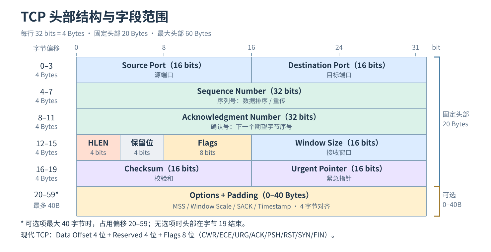

# TCP Header：结构、字段范围与作用

TCP 头部用于**连接管理、可靠传输、流量控制和差错检测**。固定长度 **20 Bytes**，Options 与 Padding 可占 **0–40 Bytes**，因此总长度为 **20–60 Bytes**。



[查看高清结构图（SVG）](./tcp-header.svg)

## 一、字段位置与作用

字节偏移从 TCP 头部第一个字节（0）开始计算。图中每行 **32 bits = 4 Bytes**。

| 字节偏移 | 字段 | 位数 | 作用 |
| --- | --- | ---: | --- |
| 0–1 | Source Port | 16 | 发送端端口 |
| 2–3 | Destination Port | 16 | 接收端端口 |
| 4–7 | Sequence Number（SEQ） | 32 | 本段第一个数据字节的序列号，用于排序、丢失检测与重传 |
| 8–11 | Acknowledgment Number（ACK） | 32 | ACK 标志有效时，表示期望收到的下一个字节序号 |
| 12（高 4 位） | Data Offset / HLEN | 4 | TCP 头部长度，单位为 4 Bytes（合法值 5–15） |
| 12（低 4 位） | Reserved | 4 | 保留位 |
| 13 | Flags | 8 | SYN、ACK、FIN、RST、PSH、URG、ECE、CWR |
| 14–15 | Window Size | 16 | 通告接收窗口（rwnd），用于流量控制 |
| 16–17 | Checksum | 16 | 校验 TCP 头、TCP 数据和 IP 伪首部 |
| 18–19 | Urgent Pointer | 16 | URG 有效时指示紧急数据边界 |
| 20–59（可选） | Options + Padding | 0–40 Bytes | MSS、Window Scale、SACK、Timestamp 等扩展及对齐填充 |

> 原始示意图采用较早的“Reserved 6 bits + Flags 6 bits”布局。本图按现代常用 TCP 格式展示为“Reserved 4 bits + Flags 8 bits”；两者的固定头部总长度相同。

## 二、Flags：连接控制

| 标志 | 作用 |
| --- | --- |
| SYN | 发起连接、同步初始序列号 |
| ACK | 表示确认号字段有效 |
| FIN | 发送方没有更多数据要发送 |
| RST | 复位连接 |
| PSH | 提示接收方及时向应用交付数据 |
| URG | 紧急指针字段有效 |
| ECE / CWR | 配合 ECN 传递和响应网络拥塞信号 |

三次握手的典型顺序：`SYN → SYN+ACK → ACK`。常见的正常连接关闭过程使用 FIN、ACK；出现异常时可能用 RST。

## 三、SEQ、ACK 与可靠传输

TCP 是**字节流协议**，SEQ 和 ACK 以字节序号为基础。

```text
Client                               Server
  |--- SEQ=1000, LEN=100 ---------->|
  |<------------- ACK=1100 --------|
```

- `SEQ=1000`：本段数据从字节序号 1000 开始。
- `LEN=100`：携带 100 字节 TCP 数据。
- `ACK=1100`：服务端已连续收到序号 1099 为止的数据，接下来期待 1100。

TCP 通过累计确认、重传和接收端乱序重组等机制向应用提供有序、可靠的字节流。**SYN 和 FIN 各占用一个序列号；纯 ACK 通常不占用序列号。**

## 四、Window Size 与拥塞控制

| 概念 | 作用 | 是否直接位于 TCP Header |
| --- | --- | --- |
| `rwnd`（接收窗口） | 防止发送方超过接收方可用接收能力 | **是**：Window Size 通告窗口，必要时由 Window Scale 扩大 |
| `cwnd`（拥塞窗口） | 由发送方根据网络拥塞状况限制在途数据 | **否**：发送端 TCP 协议栈维护 |

可简化理解为：

```text
可使用的发送窗口 ≈ min(rwnd, cwnd)
```

实际还受已发送但未确认的数据量等因素约束。**Window Size 是流量控制字段，不等于拥塞窗口，也不等于 HTTP 并发数或 QPS。**

## 五、Options：常见扩展

| 选项 | 作用 |
| --- | --- |
| MSS | 通告愿意接收的最大 TCP 数据段负载长度 |
| Window Scale | 扩大 16 位接收窗口字段可表达的实际窗口 |
| SACK | 选择性确认非连续收到的数据范围 |
| Timestamp | 辅助 RTT 测量及 PAWS 保护 |

例如：在 IPv4 无选项、TCP 无选项且路径 MTU 为 1500 Bytes 时，典型 MSS 为 `1500 - 20 - 20 = 1460 Bytes`；实际 MSS 取决于路径与协议开销。

## 六、核心内容

- **Port**：哪个应用端点在通信。
- **SEQ + ACK**：哪些字节已发送、已确认，哪些需要重传。
- **Flags**：连接如何建立、关闭或复位。
- **Window Size**：接收方还能接收多少数据。
- **Checksum + Options**：差错检测与能力扩展。

TCP 头部**不包含** HTTP URL、Token、QPS 等应用层信息；这些由 HTTP 服务器、网关或服务治理模块处理。
