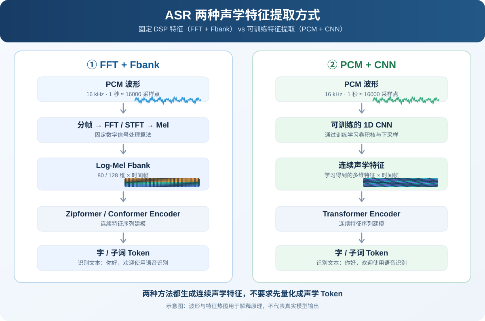

# ASR 两种声学特征提取方法：FFT/Fbank 与 PCM/CNN

ASR 模型的声学前端主要有两种常见方式：**固定的数字信号处理特征（FFT + Fbank）**，以及**直接从 PCM 学习的神经网络特征（PCM + CNN）**。

两者的主要区别是**如何从 PCM 提取声学特征**，不是是否使用深度学习。

> 图中的波形和特征热图是**原理示意**，不是某个模型的真实运行结果。

## 1. FFT + Fbank：固定算法提取声学特征

- **原理**：FFT/STFT 得到短时频谱，通过 Mel 滤波器组聚合频带能量，再取对数，得到连续的 Fbank 特征。
- **特点**：前端通常由固定信号处理算法实现；后续 Encoder 仍然是可训练的神经网络。
- **典型模型**：Zipformer、Paraformer、SenseVoice、Qwen3-ASR、Fun-ASR-Nano 等。
- **维度**：常见 80 或 128 个 Mel 频带，实际取决于具体模型配置。

## 2. PCM + CNN：通过网络学习声学特征

- **原理**：直接向 1D CNN 输入 PCM 采样序列，卷积核自动学习滤波和时间下采样，不要求显式计算 FFT/Fbank。
- **特点**：前端参数可训练，往往利用大规模自监督预训练。
- **典型模型**：wav2vec 2.0、HuBERT、WavLM、XLS-R。

## 3. 两种方法对比

| 对比项 | FFT + Fbank | PCM + CNN |
|---|---|---|
| 原始输入 | PCM | PCM |
| 特征提取方式 | 固定 FFT/STFT + Mel + Log | 可训练的 1D CNN |
| 是否显式进行 FFT | 是 | 否 |
| 输出特征 | 连续浮点向量 | 连续浮点向量 |
| 典型特征维度 | 80 / 128 维 | 由网络配置决定 |
| 前端参数是否可训练 | 通常不可训练 | 可以训练 |
| 代表模型 | Zipformer、Qwen3-ASR | wav2vec 2.0、HuBERT |

## 4. 1 秒音频的维度示例

输入为 **16 kHz、单声道、1 秒 PCM**，包含 16,000 个采样点。

- **Fbank 路线**：25 ms 帧长、10 ms 帧移、80 个 Mel 滤波器、不进行边界补帧时，约为 **98 × 80** 的特征矩阵。
- **CNN 路线**：wav2vec 2.0 Base 的典型 7 层卷积前端可得到约 **49 × 512** 的连续特征（具体帧数取决于配置与边界处理）。

## 5. 关键结论

**FFT/Fbank 是固定特征提取，PCM/CNN 是可学习特征提取。** 两种方式都可以产生连续声学特征，再由 Encoder 建模并预测字或子词 Token。

注意：**连续声学特征 ≠ 离散声学 Token**。这些 ASR 路线不要求先进行声学码本量化。
