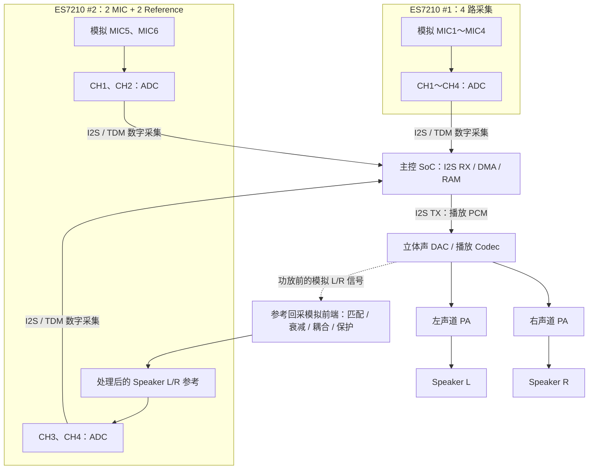
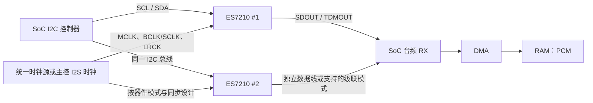
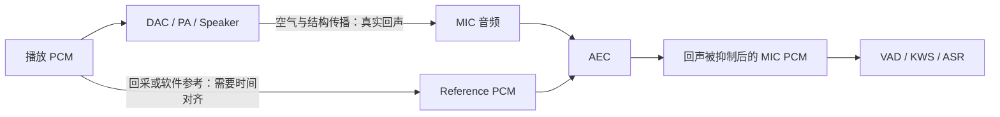

# 双 ES7210 音频采集接线：6 路麦克风 + 2 路 Speaker Reference

> 学习目标：理解模拟麦克风、ADC、Codec、I2S、I2C、DMA 的分工；画出两颗 ES7210 的采集链路、扬声器播放链路与 AEC 参考信号回采。  
> 日期：2026-10-14  
> **设计性质：通用架构示意，不代表某块开发板的已核实引脚级原理图。** 原理图连接、电源、地址、时钟、输入幅度及主控接口能力必须结合实际硬件核对。

## 1. 先说结论

ES7210 是 **4 通道音频 ADC**，擅长将最多 4 路模拟输入转换为数字音频；**它不包含用于扬声器播放的 DAC**。两颗 ES7210 理论上可以提供 8 个采集通道，但不一定意味着要接 8 个麦克风。

本例分配为 **6 路 MIC + 2 路 Speaker Reference**：

- 第一颗 ES7210：MIC1～MIC4。
- 第二颗 ES7210：MIC5、MIC6、Speaker Left Reference、Speaker Right Reference。
- 两颗芯片将采集数据经 I2S/TDM 送至主控，由 DMA 搬运到 RAM，形成相应的多通道 PCM。
- 播放链路另有 DAC/播放 Codec 和功率放大器（PA）。
- 左右 Reference 是**回采用的 ADC 输入**，不是 ES7210 输出到扬声器的信号。

> 如果设备实际采用 **ES8311（单声道 DAC）+ 单声道功放/扬声器**，并不存在天然独立的左右立体声播放参考；请按实际原理图确定是 1 路参考、2 路采样还是其他安排。这里的 L/R 仅用于说明**立体声播放设备**的一种设计方式。

## 2. 麦克风、ADC、Codec、I2S 各自负责什么？

| 名称 | 职责 | 采集/播放链路中的位置 |
|---|---|---|
| 模拟 MIC | 将空气声波转换为模拟电压 | ADC 之前 |
| 数字 MIC | 内置数字化电路，输出 PDM 或 I2S 等信号 | 通常不再经过外置模拟 ADC |
| ADC | 模数转换，将模拟电压采样成数字值 | 采集侧 |
| DAC | 数模转换，将数字 PCM 转为模拟电压 | 播放侧 |
| Audio Codec | 依型号可集成 ADC、DAC、增益、音频路由等；功能并非每颗都相同 | 采集侧和/或播放侧 |
| I2C | 控制寄存器配置，如输入增益、工作模式 | 芯片配置，不负责搬运 PCM |
| I2S / TDM | 芯片之间传输数字音频采样 | ADC/DAC 与主控之间 |
| DMA | 外设与 RAM 间高效搬运音频数据 | 主控内部 |
| PA | 将模拟信号放大到足以驱动扬声器的功率 | DAC 后、Speaker 前 |

录音的基本链路是：**MIC → 音频 ADC → I2S/TDM → SoC I2S RX → DMA → RAM → AFE/VAD/KWS/ASR**。

播放的基本链路是：**RAM 中的 PCM → DMA → SoC I2S TX → DAC/Codec → PA → Speaker**。

## 3. 两颗 ES7210 + 左右声道回采的系统框图

说明：

1. 图中两路 Reference **优先示意从 DAC/Codec 的模拟输出（功放前）获取**，必须符合 ES7210 输入电气要求。
2. 如确需从 PA 输出获取，需重新设计适配电路，**不能把 BTL 功放输出直接接入 ADC，也不能把 BTL 负端当作地线**。
3. 两颗 ES7210 的时钟、数据线具体接法可为独立数据口或芯片支持的 TDM 级联方式，不可把本图误作 GPIO 级连线图。
4. MIC 与 Reference 的数字采样需有可校准的相对时延，AEC 才能有效对齐。

### 通道映射示例

| 芯片 | ADC 通道 | 模拟输入 | 采集用途 |
|---|---|---|---|
| ES7210 #1 | CH1 | MIC1 | 语音阵列 |
| ES7210 #1 | CH2 | MIC2 | 语音阵列 |
| ES7210 #1 | CH3 | MIC3 | 语音阵列 |
| ES7210 #1 | CH4 | MIC4 | 语音阵列 |
| ES7210 #2 | CH1 | MIC5 | 语音阵列 |
| ES7210 #2 | CH2 | MIC6 | 语音阵列 |
| ES7210 #2 | CH3 | SPK_REF_L | 左播放参考 |
| ES7210 #2 | CH4 | SPK_REF_R | 右播放参考 |

ES7210 各模拟通道应按芯片数据手册的正/负模拟输入脚（例如 `MICxP / MICxN`）设计。**CH1～CH4 是逻辑通道标号，非真实 GPIO/封装脚号。**

## 4. I2C、I2S/TDM 与时钟接线

- **I2C（SCL / SDA）**：配置两颗 ES7210 的寄存器，挂同一总线时须有**不同且有效的器件地址**；具体如何选择地址需查 ADD0 等芯片引脚和数据手册，不应猜测地址。
- **MCLK**：主时钟，具体是否需要及倍频关系由工作模式决定。
- **BCLK/SCLK**：串行数据位时钟。
- **LRCK/WS**：帧同步信号。在 TDM 模式下它是多时隙帧同步，**不能把每个 ADC 通道简单理解成一根独立 I2S 线**。
- **SDOUT**：数字采集数据输出。可以选择主控支持的独立接收方案，或者符合 ES7210 手册的 TDM 级联方案。
- **同步**：多麦克风阵列、AEC 对跨芯片同步和固定延时敏感。应确认时钟源、采样率、时隙映射和数据对齐。

**注意**：两颗 ES7210 各有数字输出，并不意味着任意一颗 SoC 的一个普通 I2S 接收器都能无条件同时接收两路数据；要核对主控支持多少个 RX 数据输入、TDM 模式、DMA 格式与驱动配置。

## 5. Speaker Reference 为什么要回采？

播放声音会经空气和设备结构传到麦克风，MIC 数据里可能出现设备自身播放内容。AEC（Acoustic Echo Cancellation）通常使用一路或多路**已知的播放参考信号**，估计并减去麦克风中的回声部分。

理解差别：

- **MIC PCM**：真实麦克风接收到的声音，可能包含用户语音、噪声、扬声器回声。
- **REF PCM**：设备播放信号的参考，可能来自 DAC/PA 前后经硬件回采，也可能来自播放缓冲中的软件参考。
- **AEC 输出**：尽可能去除设备自身播放回声后的麦克风信号；AEC 不是完全消除所有环境声音。

立体声有左右两路相互独立的播放内容时，保留两路 Reference 有助于对应双声道回声路径；若左右信号实际上相同，或设备只有单声道播放，两路参考未必有意义，是否需要双参考取决于声学拓扑和 AEC 实现。

## 6. 电气设计重点：不能直接把扬声器输出接到 ES7210

**推荐的参考取样点**：DAC/播放 Codec 的功放前模拟输出，在符合 ADC 输入满量程、共模电压及差分/单端要求的前提下，经过合适的耦合、滤波、增益和保护电路后回采。

**PA 后回采**：功放特别是 Class-D BTL 输出可能有较大的共模/差模电压以及高频开关分量。必须查阅实际 PA、ES7210 和板卡原理图，设计符合额定电压、带宽、共模范围、抗混叠与保护要求的差分衰减/滤波链路。**不得直接相连，不得把 BTL 的 SPK− 端接系统 GND。**

还需要核对：

- 模拟 MIC 的偏置电源、输入耦合、电源滤波和增益；
- ES7210 的模拟电源、数字电源和地规划；
- 实际 REF 节点是 DAC 前、DAC 后、PA 前还是 PA 后；
- 各通道是否削波（clipping）、是否被静音/增益控制影响；
- TDM 时隙与 DMA 内存交织顺序；
- 两颗 ES7210 的有效 I2C 地址、工作模式、上电时序。

**参考真实方案**：乐鑫 ESP32-S3-Korvo-2 使用 ES7210 接收 AEC 参考。其公开文档同时列出从 ES8311 DAC 输出及从 NS4150 PA 输出取参考的兼容方案，默认推荐 **DAC 输出回采**。注意该板本身采用的是单声道播放路径，不能把它误认为本文的双 ES7210、立体声 6+2 拓扑。

## 7. PCM 与带宽示例

设定 **16 kHz、16-bit、8 通道**，不计总线填充与协议开销：

- 每秒每通道样本数：`16000`。
- 每个样本字节数：`16 / 8 = 2 B`。
- 8 路净 PCM 吞吐：`16000 × 2 × 8 = 256000 B/s`，约 **250 KiB/s**。
- 10 ms 共 8 通道的采样：`160 × 8 = 1280` 个样本，16-bit 数据约 **2560 B**。

注意这只是**有效 PCM 负载**；I2S/TDM 的实际 BCLK 还与每个时隙的位宽、时隙数、帧结构有关。例如 8 时隙、每时隙 32 位、16 kHz 时，理论 BCLK 为 `16000 × 8 × 32 = 4.096 MHz`，前提是所选器件/模式确实支持这个配置。

## 8. 开发板实操核对清单

1. 阅读 PCB BOM/原理图，确定**确实装有两颗 ES7210**，记录器件编号。
2. 从每个 ES7210 的 `MICxP/MICxN` 反向追线，标清输入究竟是 MIC、Speaker Reference 还是悬空。
3. 检查 Speaker 的真实数量与是否独立立体声；核对播放 Codec、DAC、PA 型号。
4. 找到 `I2C SCL/SDA`、地址选择、`MCLK/BCLK/LRCK/SDOUT` 对应主控引脚与时钟关系。
5. 从固件确认采样率、位宽、I2S/TDM 模式、时隙排列与 DMA buffer 布局。
6. 对每路单独注入/播放已知信号，确认 8 个 PCM 通道的顺序、幅度、串扰和同步。
7. 分别录制**静音、近讲、左声道播放、右声道播放、边播边讲**样本，验证两个 Reference 的对应关系和 AEC 效果。

验收产物应包括：**真实引脚级接线图、8 路通道映射表、16 kHz 多通道 PCM 录音、AEC 前后对比音频**。若尚未拿到原理图，以上连接仅视为待验证设计。

## 9. 相关资料

- [乐鑫 ESP32-S3-Korvo-2：AEC 参考采集设计](https://docs.espressif.com/projects/esp-board-manager/en/latest/references/boards/esp32_s3_korvo_2_3.html)
- [ESP32-S3-Korvo-2 V3.0 原理图（PDF）](https://dl.espressif.com/dl/schematics/SCH_ESP32-S3-KORVO-2_V3_0_20210918.pdf)
- [ESP32-S3 I2S 外设指南](https://docs.espressif.com/projects/esp-idf/en/stable/esp32s3/api-reference/peripherals/i2s.html)
- [本站：声学与音频基础概念手册](./audio-acoustics-and-esp32-guide.html)

---

**一句话总结**：两颗 ES7210 负责**采集**，可以安排成 6 路模拟 MIC + 2 路扬声器参考；它们通过数字音频接口将 PCM 送入主控。扬声器由另一个 DAC/Codec 和 PA 驱动，Reference 必须通过满足电气规范的模拟路径回采，最终供 AEC 使用。
