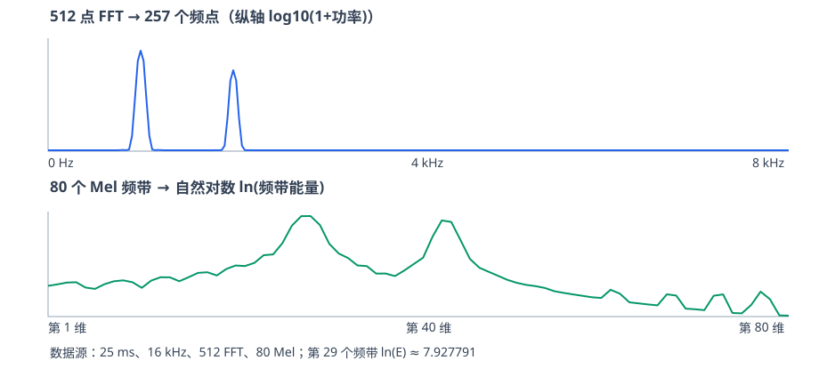
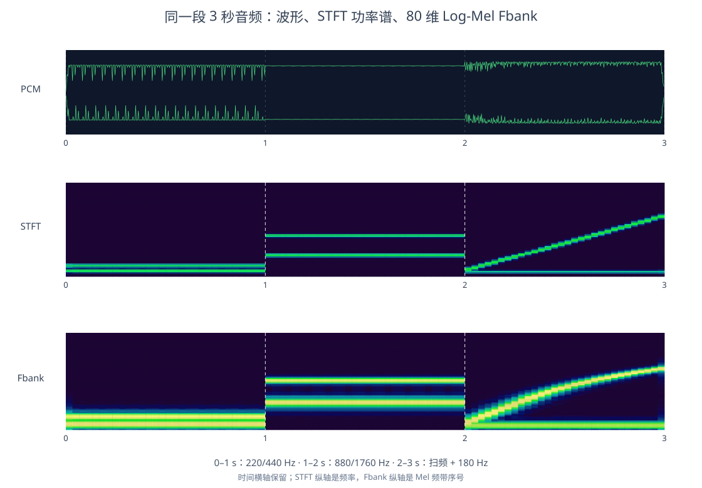

# Fbank 音频特征提取完整教程：从 PCM、Hann、FFT 到 80 维 Log Fbank

> 适用：希望掌握音频信号处理、STFT、滤波器组和 ASR 声学特征的开发者。  
> **Demo 使用**：16 kHz、单声道 S16LE、25 ms 帧长、10 ms 帧移、周期 Hann 窗、512 点 FFT、80 个 Mel 滤波器，计算自然对数 Log Fbank。所有数值均可由同目录中的 Python 脚本复算。  
> **重点**：**Mel Fbank 不是直接对 25 ms PCM 做 80 次时域滤波，而是先算 FFT 功率谱，再按 80 组频域权重进行加权求和。**

> **在线实验文件**：[Python 单帧完整计算](fbank-complete-demo/fbank_step_by_step.py) · [Python 多帧](fbank-complete-demo/fbank_multiframe_demo.py) · [257 频点数据](fbank-complete-demo/fft_257_bins.csv) · [80 频带数据](fbank-complete-demo/fbank_80_bins.csv) · [Fbank 基础原理](fbank-principles.html)

## 目录

1. [Fbank 是什么？与波形、频谱、声谱图的关系](#1-fbank-是什么与波形频谱声谱图的关系)
2. [实验规格和数据流](#2-实验规格和数据流)
3. [PCM 解码与分帧](#3-pcm-解码与分帧)
4. [Hann 加窗](#4-hann-加窗)
5. [补零、FFT 和复数的实部与虚部](#5-补零fft-和复数的实部与虚部)
6. [由 FFT 复数计算功率谱](#6-由-fft-复数计算功率谱)
7. [构造 Mel 滤波器组](#7-构造-mel-滤波器组)
8. [257 个频点如何变为 80 个频带能量：完整手算](#8-257-个频点如何变为-80-个频带能量完整手算)
9. [取 Log：得到 80 维特征](#9-取-log得到-80-维特征)
10. [1 秒音频怎样得到 98×80 特征矩阵？](#10-1-秒音频怎样得到-9880-特征矩阵)
11. [代码与结果文件](#11-代码与结果文件)
12. [工程差异、常见误区与复习要点](#12-工程差异常见误区与复习要点)

---

## 1. Fbank 是什么？与波形、频谱、声谱图的关系

**波形 Waveform**：横轴是时间，纵轴是振幅。16 kHz 单声道 PCM 就是每秒 16000 个振幅采样点。  
**频谱 Spectrum**：横轴是频率，纵轴通常为幅度或功率；描述一小段声音中每种频率成分的强弱。  
**声谱图 Spectrogram**：横轴是时间，纵轴是频率，颜色表示各时间帧、各频点的强弱。  
**Mel Fbank**：先将每帧的 FFT 功率谱映射到 Mel 频率刻度上的多个频带；每个频带输出一个加权能量。常见模型使用其对数形式 **Log-Mel Fbank**。

```text
时域 PCM 波形 ──逐帧加窗──► STFT/FFT 复数频谱
                                   │
                                |X[k]|²
                                   ▼
                            频谱功率 257 维
                                   │
                         80×257 Mel 权重矩阵
                                   ▼
                            80 维 Mel 能量
                                   │  ln
                                   ▼
                           80 维 Log Fbank
```

**STFT**（Short-Time Fourier Transform，短时傅里叶变换）是“对连续音频滑动分帧、每帧加窗并 FFT”的整体过程；FFT 本身只是在某一帧上计算 DFT 的高效算法。

**“能量”不等于音量**：Fbank 能量是某个频带的信号强度相关指标，但不是经过人耳听觉加权测量的响度，也不自动是 dBFS 或物理瓦特。

## 2. 实验规格和数据流

| 参数 | Demo 设定 | 为什么 |
|---|---:|---|
| `fs` | 16000 Hz | 采样率，允许表示至多 8000 Hz 的非负频率成分（奈奎斯特） |
| `Tframe` | 25 ms | 单次频谱分析所覆盖的音频时长 |
| `Thop` | 10 ms | 每隔 10 ms 开始下一帧；因此相邻窗口重叠 15 ms |
| `N` | 400 | `16000 × 0.025`，帧内 PCM 点数 |
| `Nfft` | 512 | FFT 使用补零后的 512 点长度 |
| `Nfreq` | 257 | 实信号 FFT 的非负频率结果为 `512/2+1` |
| `Δf` | 31.25 Hz | 相邻 FFT 频点坐标的间隔为 `16000/512` |
| `Nmel` | 80 | 每帧输出 80 维频带能量 |
| Mel 范围 | 0～8000 Hz | 教学实现采用全频带（部分工业实现下限为 20 Hz） |
| 对数 | 自然对数 `ln` | `ln(max(E,1e-10))` 防止 `ln(0)` |

数组形状沿链路变化：

```text
PCM int16[400]
  -> 浮点 x[400]
  -> Hann 窗后 y[400]
  -> 补零 z[512]
  -> rFFT 复数 X[257]
  -> 功率 P[257]
  -> Mel 权重矩阵 H[80,257] @ P[257]
  -> Mel 频带能量 E[80]
  -> Log Fbank F[80]
```



## 3. PCM 解码与分帧

### 3.1 用一段容易观察频谱的音频做实验

本 Demo 生成两个正弦分量，频率分别为 1000 Hz 和 2000 Hz：

<div class="math-block">\[s(t)=0.55\sin(2\pi\cdot1000t)+0.25\sin(2\pi\cdot2000t+\pi/4)\]</div>

以 `fs=16000` 采样：

<div class="math-block">\[s[n]=0.55\sin\left(2\pi\frac{1000n}{16000}\right)+0.25\sin\left(2\pi\frac{2000n}{16000}+\frac\pi4\right)\]</div>

取 `n=0,1,...,399`，量化并保存为 S16LE PCM：

<div class="math-block">\[p[n]=\mathrm{clip}\left(\mathrm{round}(32767s[n]),-32768,32767\right)\]</div>

其中 **S16LE** = signed 16-bit little endian：每个采样点是带符号的 16 位整数，以低字节在前的方式存储。裸 PCM 没有采样率/声道等文件头，WAV 则包含音频元信息。

### 3.2 转为浮点数以便计算

<div class="math-block">\[x[n]=p[n]/32768\]</div>

| n | 时间（ms） | int16 PCM `p[n]` | 归一化 `x[n]` |
|---:|---:|---:|---:|
| 0 | 0.0000 | 5792 | +0.176757812 |
| 1 | 0.0625 | 15088 | +0.460449219 |
| 2 | 0.1250 | 18536 | +0.565673828 |
| 3 | 0.1875 | 16650 | +0.508117676 |

`n` 是采样点的**时间索引**，不是频率的索引。比如 `n=1` 表示从起点起经过 `1/16000 s = 0.0625 ms` 的一个波形振幅值。

### 3.3 分帧与重叠（STFT 的第一部分）

一般语音是连续不断的，不能只提一次 Fbank。因此用 400 个点的分析窗、160 个点的帧移：

```text
原始 PCM： [0 ......................................... 15999]
第 0 帧：   [0 ........ 399]                    25 ms
第 1 帧：         [160 ........ 559]            从 10 ms 开始
第 2 帧：               [320 ........ 719]      从 20 ms 开始
                ↑ 相邻帧重叠 240 个点 = 15 ms
```

第 `t` 帧对应原始采样点：

<div class="math-block">\[x_t[n]=x_{\text{all}}[t\cdot160+n],\quad 0\le n<400\]</div>

**分帧不是降采样**：没有删除原始 PCM 的采样点；只是重复读取局部 25 ms 片段来分析。帧移 10 ms 也不意味着 PCM 采样率从 16 kHz 变成 100 Hz；**100 帧/秒是特征的时间步率**，不是原始音频采样率。

## 4. Hann 加窗

### 4.1 为什么要乘窗？

截取 25 ms 相当于把无限长的信号截断。直接对突然切断的帧做频谱分析，通常会出现额外的频谱泄漏。Hann 窗在两端衰减，可以减轻帧边界的不连续。

**注意这个 Demo 采用周期 Hann 窗**（有些文档使用分母为 `399` 的对称 Hann 窗）：

<div class="math-block">\[\boxed{w[n]=0.5-0.5\cos\left(\frac{2\pi n}{400}\right)},\quad n=0,\ldots,399\]</div>

逐点乘法：

<div class="math-block">\[y[n]=x[n]w[n]\]</div>

| n | 原始浮点 `x[n]` | 窗权重 `w[n]` | 乘积 `y[n]` |
|---:|---:|---:|---:|
| 0 | +0.176757812 | 0 | 0 |
| 1 | +0.460449219 | 0.000061684 | +0.000028402 |
| 2 | +0.565673828 | 0.000246720 | +0.000139563 |
| 3 | +0.508117676 | 0.000555063 | +0.000282037 |
| 100 | 按数组计算 | 0.5 | 原值的 0.5 倍 |
| 200 | 按数组计算 | 1.0 | 不变 |
| 399 | 按数组计算 | 0.000061684 | 接近 0 |

窗口操作不会生成新的频率标签或更改采样率，只是对时间样本做权重衰减；它会改变 FFT 的谱形与绝对幅度。

## 5. 补零、FFT 和复数的实部与虚部

### 5.1 为什么从 400 点补到 512 点？

<div class="math-block">\[z[n]=\begin{cases}y[n],&0\le n<400\\0,&400\le n<512\end{cases}\]</div>

补 112 个零之后可以方便地执行 512 点 FFT。**补零使频谱坐标更密，但不会增加原先 25 ms 音频的真实频率辨别能力。**

对 512 个点进行 DFT（FFT 是快速算法）：

<div class="math-block">\[X[k]=\sum_{n=0}^{511}z[n]e^{-j2\pi kn/512}\]</div>

欧拉公式：

<div class="math-block">\[e^{-j\theta}=\cos\theta-j\sin\theta\]</div>

因此，把一个 FFT 复数拆成两个实际可算的数：

<div class="math-block">\[\boxed{R[k]=\sum_{n=0}^{399}y[n]\cos\left(\frac{2\pi kn}{512}\right)}\]</div>

<div class="math-block">\[\boxed{I[k]=-\sum_{n=0}^{399}y[n]\sin\left(\frac{2\pi kn}{512}\right)}\]</div>

<div class="math-block">\[\boxed{X[k]=R[k]+jI[k]}\]</div>

注意：求和到 399 是因为其余 112 点为 0。`k` 是**频率序号**，`n` 是**时间采样点序号**；为了求一个 `k` 的复数，要对整个分析帧的 400 个 `n` 累加。**FFT 的第 32 个频点不是 PCM 的第 32 个采样点。**

### 5.2 FFT 的第 k 个点是多少 Hz？

<div class="math-block">\[f_k=\frac{k\cdot16000}{512}=31.25k\text{ Hz}\]</div>

例如 `k=32` 对应 `1000 Hz`；`k=64` 对应 `2000 Hz`；`k=256` 是 `8000 Hz`。

由于实数 PCM 的频谱具有共轭对称性，保留 `k=0..256` 即可，合计：

<div class="math-block">\[\frac{512}{2}+1=257\text{ 个复数}\]</div>

### 5.3 手动推导 1000 Hz 频点的复数

代入 `k=32`：

<div class="math-block">\[R[32]=\sum_{n=0}^{399}y[n]\cos(\pi n/8)\]</div>

<div class="math-block">\[I[32]=-\sum_{n=0}^{399}y[n]\sin(\pi n/8)\]</div>

前 3 个非零样本的单项贡献：

| n | `y[n]` | 对实部 `y[n]cos(πn/8)` 的贡献 | 对虚部 `−y[n]sin(πn/8)` 的贡献 |
|---:|---:|---:|---:|
| 1 | 0.000028402 | +0.000026240 | −0.000010869 |
| 2 | 0.000139563 | +0.000098686 | −0.000098686 |
| 3 | 0.000282037 | +0.000107931 | −0.000260568 |

把 `n=0..399` 全部累加，真实结果约为：

<div class="math-block">\[\boxed{X[32]=-0.0003524-54.9982169j}\]</div>

```python
# 同一 1000 Hz 频点，手算式求和与快速 FFT 互相验证
n = np.arange(400)
theta = 2 * np.pi * 32 * n / 512
real = np.sum(y * np.cos(theta))
imag = -np.sum(y * np.sin(theta))
assert np.allclose(real + 1j * imag, np.fft.rfft(y, n=512)[32])
```

### 5.4 实部与虚部为什么都需要？

它们共同描述该频率成分的**幅度与相位**：

<div class="math-block">\[|X[k]|=\sqrt{R[k]^2+I[k]^2},\qquad \phi[k]=\operatorname{atan2}(I[k],R[k])\]</div>

对于 `k=32`，幅度约 `54.9982`，相位约 `−90°`。虚部是负数不意味着这个频率“能量为负”。

| k | 频率 | 实际 FFT 结果（近似） |
|---:|---:|---|
| 0 | 0 Hz | `−0.0007629 + 0j` |
| 31 | 968.75 Hz | `+23.1449112 + 28.2014722j` |
| 32 | 1000 Hz | `−0.0003524 − 54.9982169j` |
| 33 | 1031.25 Hz | `−23.1449989 + 28.2022473j` |
| 64 | 2000 Hz | `+17.6768371 − 17.6772186j` |

## 6. 由 FFT 复数计算功率谱

Fbank 一般不直接使用相位。先取模平方：

<div class="math-block">\[\boxed{P[k]=|X[k]|^2=R[k]^2+I[k]^2}\]</div>

1000 Hz 的例子：

<div class="math-block">\[P[32]=(-0.0003524)^2+(-54.9982169)^2\approx\boxed{3024.803865}\]</div>

| k | 频率 Hz | `P[k]`（实际值，近似） |
|---:|---:|---:|
| 31 | 968.75 | 1331.009947 |
| 32 | 1000.00 | **3024.803865** |
| 33 | 1031.25 | 1331.057727 |
| 63 | 1968.75 | 275.022333 |
| 64 | 2000.00 | **624.954628** |
| 65 | 2031.25 | 274.989972 |

**为什么 968.75 Hz 和 1031.25 Hz 也有明显功率？** 25 ms 的有限窗长度形成了宽度有限的频谱主瓣；FFT 的多个频点会对同一个正弦分量有响应，尤其在加窗与补零后很直观。这不表示源音频中另外录入了两个独立的纯音。

**量纲说明**：这个教学例子使用未归一化的 `|FFT|²`，因此 `3024.8` 是此算法约定下的谱功率数值，不是 W、Pa²、dBFS 或人耳响度。有的库使用幅度谱 `|FFT|`，有的归一化为功率谱密度，数值可能完全不同。

## 7. 构造 Mel 滤波器组

### 7.1 为什么需要 Mel？

线性 FFT 的 257 个频点在 Hz 轴上等间隔（31.25 Hz）；语音识别往往更关心与听觉相关的、**低频较密而高频较疏**的频带分布。Mel 标度是一种近似人类音高感知的频率刻度。

本 Demo 使用 HTK 形式：

<div class="math-block">\[\boxed{M(f)=2595\log_{10}\left(1+\frac f{700}\right)}\]</div>

逆变换：

<div class="math-block">\[\boxed{f(M)=700\left(10^{M/2595}-1\right)}\]</div>

操作是：

1. 将 `0 Hz` 和 `8000 Hz` 转成 Mel 值；
2. **在 Mel 域均匀取 82 个节点**（80 个三角滤波器需要两侧边界）；
3. 把这 82 个 Mel 值换回 Hz：`b[0], ..., b[81]`；
4. 对于第 `m` 个滤波器，用 `b[m], b[m+1], b[m+2]` 作左边界、中心、右边界；
5. 在 FFT 的 257 个频率坐标上计算每个滤波器的三角形权重。

前几个频带的实际边界：

| 滤波器（从 1 开始） | 左 Hz | 中心 Hz | 右 Hz |
|---:|---:|---:|---:|
| 1 | 0.00000 | 22.12007 | 44.93913 |
| 2 | 22.12007 | 44.93913 | 68.47927 |
| 3 | 44.93913 | 68.47927 | 92.76329 |
| 4 | 68.47927 | 92.76329 | 117.81469 |
| 5 | 92.76329 | 117.81469 | 143.65771 |

### 7.2 三角滤波器的权重公式

假设某个滤波器的左边界为 `fL`、中心为 `fC`、右边界为 `fR`，对第 `k` 个 FFT 频点 `f[k]`：

<div class="math-block">\[\boxed{H_m[k]=\begin{cases}
0,&f_k\le f_L\text{ 或 }f_k\ge f_R\\
\frac{f_k-f_L}{f_C-f_L},&f_L<f_k\le f_C\\
\frac{f_R-f_k}{f_R-f_C},&f_C<f_k<f_R
\end{cases}}\]</div>

**“滤波器组”在这里指一组频域权重，不是硬件滤波器，也不意味着重新产生 80 段 PCM 波形。** 相邻三角窗会重叠，单个 FFT 频点可能对相邻两个滤波器同时产生贡献。

共 80 个滤波器、每个 257 个权重：

<div class="math-block">\[\boxed{H\in\mathbb{R}^{80\times257}}\]</div>

## 8. 257 个频点如何变为 80 个频带能量：完整手算

第 `m` 个 Mel 频带的能量：

<div class="math-block">\[\boxed{E_m=\sum_{k=0}^{256}H_m[k]\cdot P[k]}\]</div>

矩阵形式（**最适合在代码中实现**）：

<div class="math-block">\[\boxed{E_{80\times1}=H_{80\times257}\;P_{257\times1}}\]</div>

以**第 29 个 Mel 滤波器**为例（代码里的 0-based 下标 `m=28`）：

- 左边界：`972.69394 Hz`
- 中心：`1025.55123 Hz`
- 右边界：`1080.07881 Hz`
- 该三角滤波器权重非零的 FFT 点只有 `k = 32, 33, 34`

真实权重乘法：

| FFT 频点 k | 频率 Hz | 功率 `P[k]` | 权重 `H[28,k]` | `P × H` |
|---:|---:|---:|---:|---:|
| 32 | 1000.00 | 3024.803865 | 0.5165997 | 1562.612808 |
| 33 | 1031.25 | 1331.057727 | 0.8954882 | 1191.946553 |
| 34 | 1062.50 | 58.112283 | 0.3223838 | 18.734458 |

完整精度求和：

<div class="math-block">\[\begin{aligned}
E_{28}&=\sum_{k=0}^{256}H_{28}[k]P[k]\\
&\approx1562.612808+1191.946553+18.734458\\
&\approx\boxed{2773.293818}
\end{aligned}\]</div>

这里 `E[28]` 指**第 29 个**滤波器，因为 Python 的下标从 0 开始。其余 79 个滤波器独立执行相同计算，得到数组 `E.shape = (80,)`。

**为什么不直接挑出 80 个 FFT 点？** 因为每个 Mel 频带并非一个离散频率点，而是一个**有宽度的频率范围**；对邻近 FFT 点加权有助于汇总局部频谱结构，减弱对单个 FFT bin 的依赖。

## 9. 取 Log：得到 80 维特征

线性频带能量差异很大；取对数压缩动态范围，通常更适合语音模型处理：

<div class="math-block">\[\boxed{F_m=\ln\left(\max(E_m,10^{-10})\right)}\]</div>

还是看第 29 个滤波器：

<div class="math-block">\[F[28]=\ln(2773.293818)\approx\boxed{7.927791}\]</div>

几个实际频带：

| 滤波器序号 | 线性频带能量 `E` | Log Fbank `ln(E)` |
|---:|---:|---:|
| 1 | 0.000001482 | −13.421809 |
| 2 | 0.000002385 | −12.946212 |
| 3 | 0.000004102 | −12.404157 |
| 28 | 2708.951126 | 7.904317 |
| 29 | 2773.293818 | **7.927791** |
| 30 | 180.126867 | 5.193661 |

**为什么 Log Fbank 有负数？** 因为 `0<E<1` 时 `ln(E)<0`，不代表负能量。**Log Fbank 也不直接等于 dBFS**：本例使用 `ln`，而功率分贝换算通常使用 `10·log10(P/P_ref)`，两者的标度与参考值都不同。

最终 80 个值是这**一帧（25 ms）**的声学频带特征，不是 80 个采样点、80 个语音音素或 80 个新音频通道。

## 10. 1 秒音频怎样得到 98×80 特征矩阵？

1 秒、16 kHz 单声道 PCM 有 16000 个样本。若**只提取完整窗口**，不对起止两端补帧：

<div class="math-block">\[T=\left\lfloor\frac{16000-400}{160}\right\rfloor+1
=\boxed{98\text{ 帧}}\]</div>

每帧有 80 维 Log Fbank，因此：

<div class="math-block">\[\boxed{\operatorname{Fbank}\in\mathbb R^{98\times80}}\]</div>

- 第 1 维：时间帧索引。起点为 `0 ms,10 ms,20 ms,...,970 ms`；每帧内部覆盖 25 ms。
- 第 2 维：Mel 频带索引。80 个频带从低频到高频排序。
- 矩阵中的每个值：该时间帧、该 Mel 频带的**对数频带能量**。

下图是另一个实测 Demo：前约 1/3 秒为 300 Hz，中间约 1/3 秒为 1000 Hz，后约 1/3 秒为 2000 Hz。对其逐帧提取，比较 257 维 STFT 功率谱与 80 维 Log Fbank：



> 图为仓库现有的连续音频特征示意，实际 98×80 特征可运行下方多帧脚本生成。

**观察方法**：横轴是时间；高能量颜色区域随着音频从低频变成高频而向上移动。Fbank 在频率方向上压缩信息，但**时间顺序仍保留**。这也是它可以用于 ASR、KWS、VAD 等任务的基础。

> 边缘补帧选项会改变帧数。比如有的模型在音频首尾补点或将时间中心放在固定时刻，1 秒未必恰好 98 帧；本例是 `snip_edges` 风格的完整窗口计数。

## 11. 代码与结果文件

### 11.1 运行

在仓库根目录执行：

```bash
python3 -m pip install numpy matplotlib
python3 speech/fbank-complete-demo/fbank_step_by_step.py
python3 speech/fbank-complete-demo/fbank_multiframe_demo.py
```

[下载单帧代码](fbank-complete-demo/fbank_step_by_step.py) · [下载多帧代码](fbank-complete-demo/fbank_multiframe_demo.py) · [查看运行说明](fbank-complete-demo/README.md)

### 11.2 从 400 点计算 80 维 Fbank 的关键代码

```python
import numpy as np

fs, N, n_fft, n_mels = 16000, 400, 512, 80

# 400 个 int16 PCM 样本。完整生成方法见 fbank_step_by_step.py
pcm = ...
x = pcm.astype(np.float64) / 32768.0

# Hann: n = 0..399
n = np.arange(N)
w = 0.5 - 0.5 * np.cos(2 * np.pi * n / N)
y = x * w

# 等价于对 y 在尾部补 112 个零，再做 512 点 FFT
X = np.fft.rfft(y, n=n_fft)   # (257,), 复数
P = np.abs(X)**2             # (257,), 浮点

# 构造 Mel 频率节点并计算 80×257 三角权重
hz_to_mel = lambda f: 2595 * np.log10(1 + f/700)
mel_to_hz = lambda m: 700 * (10**(m/2595) - 1)
mel_pts = np.linspace(hz_to_mel(0), hz_to_mel(fs/2), n_mels+2)
hz_pts = mel_to_hz(mel_pts)
freq = np.fft.rfftfreq(n_fft, d=1/fs)
H = np.zeros((n_mels, 257))
for m in range(n_mels):
    L, C, R = hz_pts[m:m+3]
    rise = (freq - L) / (C - L)
    fall = (R - freq) / (R - C)
    H[m] = np.maximum(0, np.minimum(rise, fall))

E = H @ P                     # (80,), 频带能量
F = np.log(np.maximum(E, 1e-10))  # (80,), Log Fbank
print(F.shape, F[28])         # (80,) 约 7.927791
```

上面 `pcm = ...` 表示需替换为**实际 `int16` 的 400 个 PCM 数组**；如果希望一条命令直接运行，请用同目录的完整脚本 `fbank_step_by_step.py`，它已内置可复现测试 PCM 的生成过程。

### 11.3 文件及其用途

| 文件 | 用途 |
|---|---|
| `fbank_step_by_step.py` | 25 ms 单帧：从 PCM、Hann、FFT 实虚部、功率谱到 80 维特征的完整脚本 |
| `fbank_multiframe_demo.py` | 1 秒多帧分析；导出 `98×257` 与 `98×80` 矩阵并绘图 |
| `tone_25ms_s16le.pcm` / `tone_25ms_16k_mono.wav` | 25 ms 裸 PCM 和 WAV |
| `tone_1second_three_phases.wav` | 能听到前后频率变化的 1 秒音频 |
| `numeric_trace.txt` | 每一步的实际数值、频带加权乘法展开 |
| `fft_257_bins.csv` | 257 个 FFT 频点对应的实部、虚部、幅度、功率 |
| `mel_weights_80x257.csv` | 80×257 滤波器权重矩阵 |
| `filter_near_1khz_detail.csv` | 第 29 个滤波器的逐频点加权明细 |
| `fbank_80_bins.csv` | 所有 80 个频带边界、中心、线性能量及 Log 能量 |
| `fbank_intermediates.npz` | 单帧全部中间 NumPy 数组 |
| `log_fbank_98x80.npy` | 1 秒音频的 98×80 特征矩阵 |
| `fbank-complete-demo/fft_to_fbank.svg` / `fbank_assets/images/04_wave_stft_logmel.svg` | 仓库内的数值可视化与多帧示意；单帧脚本也可输出 PNG |

## 12. 工程差异、常见误区与复习要点

### 12.1 工程模型可能与教学 Demo 得出不同数字

这份教程明确采用 **HTK Mel 频率刻度 + Hz 轴线性三角滤波器 + 峰值权重为 1 + 不做面积归一化 + 周期 Hann + 不做预加重、去直流和 CMVN**。完整前端实现可能使用：

| 实现选项 | 作用 / 可能导致的差异 |
|---|---|
| 预加重 `y[n]=x[n]-αx[n-1]` | 可提升高频相对权重；系数 `α` 常见约 0.97；不是所有模型都启用 |
| 去直流 DC removal | 从每帧减去平均值，减少 0 Hz 附近偏置 |
| Hann / Hamming / Povey 等窗 | 频谱泄漏、主瓣形状及幅度会变化 |
| 是否补零、FFT 点数 | 决定离散频率采样坐标和频点数量 |
| 取幅度还是功率 | `|X|` 与 `|X|²` 会得到不同结果 |
| Mel 公式 HTK / Slaney | 频率刻度不同，滤波器中心不同 |
| Hz 域三角形 / Mel 域三角形 | 滤波器权重不同；**Kaldi 风格并不等于本 Demo 的 Hz 域三角形** |
| 峰值归一化 / 面积归一化 | 改变各频带能量的数值比例 |
| `ln` / `log10` / dB | 输出标度不同，不能直接混用 |
| CMVN（均值方差归一化） | 通常在特征生成之后再处理，不是 FFT 或 Mel 的定义部分 |
| 边缘补帧和时间居中 | 决定总帧数以及时间标签如何标注 |

参考文档（用来比较**工程实现的参数**，不意味着本例与这些库数值完全一致）：

- [PyTorch / Torchaudio: `torchaudio.compliance.kaldi.fbank`](https://docs.pytorch.org/audio/stable/generated/torchaudio.compliance.kaldi.fbank.html) —— 公开了 `frame_length`、`frame_shift`、`window_type`、`preemphasis_coefficient`、`num_mel_bins`、`use_log_fbank` 等参数。
- [Librosa: `librosa.filters.mel`](https://librosa.org/doc/0.11.0/generated/librosa.filters.mel.html) —— 明确 `htk` 和 `norm` 两类参数，并说明 Mel 权重矩阵。

### 12.2 五个最容易误解的地方

1. **25 ms ≠ 一个频点**：25 ms 对应 400 个时间采样点；FFT 的某一频点根据这 400 个时间点一起计算。
2. **257 个复数 ≠ 257 个独立声音**：FFT bin 是预设的频率坐标；每个 bin 的复数描述该频率基上的投影。实数 FFT 只保留共轭对称的一半。
3. **80 维 Fbank ≠ 80 个具体的离散频率**：是 80 个有宽度的频带，每个输出都是多个 FFT bin 的加权总和。
4. **频谱并非一定能无损恢复 PCM**：完整复数 FFT 可以逆变换（满足对应的分帧/窗/边缘重建条件）；取模平方丢相位，再压成 80 维并取对数后，通常无法精确还原原波形。
5. **Fbank 保留时间维度**：一帧是 `80`，连续 98 帧是 `98×80`。它能同时描述哪些频带强、这些频带在哪个时间段强。

### 12.3 一张公式表串起来

<div class="math-block">\[\begin{aligned}
&\text{(1) PCM 解码:}&&x[n]=p[n]/32768\\
&\text{(2) 加窗:}&&y[n]=x[n](0.5-0.5\cos(2\pi n/400))\\
&\text{(3) FFT 实部:}&&R[k]=\sum_{n=0}^{399}y[n]\cos(2\pi kn/512)\\
&\text{(4) FFT 虚部:}&&I[k]=-\sum_{n=0}^{399}y[n]\sin(2\pi kn/512)\\
&\text{(5) 功率谱:}&&P[k]=R[k]^2+I[k]^2\\
&\text{(6) 频带能量:}&&E[m]=\sum_{k=0}^{256}H[m,k]P[k]\\
&\text{(7) Log Fbank:}&&F[m]=\ln(\max(E[m],10^{-10}))
\end{aligned}\]</div>

**最终结论**：

```text
一帧：400 个 PCM 采样点 → 257 个 FFT 复数 → 257 个功率值
     → Mel 权重矩阵 80×257 → 80 个频带能量 → 80 维 Log Fbank

一秒：16000 个 PCM 点 → 98 个完整帧（25 ms 窗，10 ms 帧移）
     → 98×80 的 Log Fbank 声学特征矩阵
```

此矩阵可以作为 ASR（如使用 Fbank 前端的 Zipformer 等模型）、KWS 和其他语音模型的输入；如果模型有不同的前端配置，**应按模型实际训练时的参数提取特征**。

<!-- Online renderer for display equations on the published GitHub Pages HTML. -->
<script>window.MathJax={tex:{displayMath:[["\\[","\\]"],["$$","$$"]]},svg:{fontCache:"global"}};</script>
<script defer src="https://cdn.jsdelivr.net/npm/mathjax@3.2.2/es5/tex-svg.js"></script>
