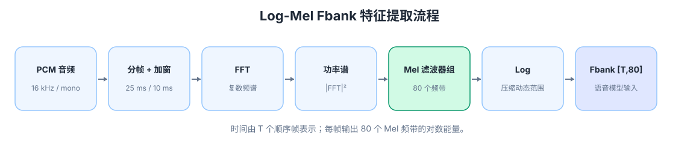
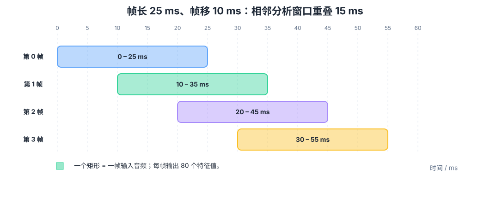
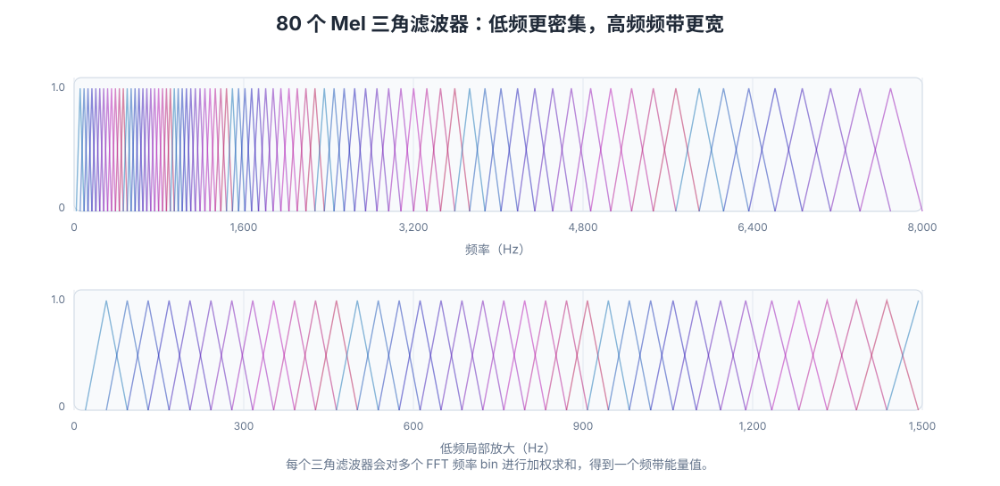

# Fbank（Mel 滤波器组）原理详解

> 适用主题：音频信号处理 / ASR / KWS / Zipformer / 神经网络声学特征  
> 示例配置：16 kHz、单声道、帧长 25 ms、帧移 10 ms、80 个 Mel 频带。  
> 本文配有 **4 张示意图、2 段 WAV 音频、1 份 298×80 的实际特征矩阵和可运行的 Python 代码**。配套图片、音频、数据与脚本均存放于同目录的 `fbank_assets/` 中，可在线查看或下载。

## 一、一句话理解

**Fbank（Filter Bank）在语音识别语境中，通常指 Mel 滤波器组特征；常用的是 Log-Mel Filterbank（对数 Mel 滤波器组特征）。**

它将 PCM 音频按时间切成短帧，对每一帧计算频谱，再用一组 **Mel 频带权重** 对频谱做加权汇总，得到每帧的若干能量特征。常见的 80 维 Fbank，就是 **每帧 80 个频带能量特征**，而不是 80 个声音通道或 80 个独立的正弦频率。

> **重要区别**：Fbank 的三角滤波器是在**频谱上做加权汇总**，不是把 PCM 逐路滤波后得到 80 条可以单独播放的音轨。

## 二、整体计算流程



```text
PCM 波形 x[n]
  │
  ├─ 分帧：25 ms / 帧；帧移：10 ms
  │
  ├─ 加窗：例如 Hann 窗，减轻频谱泄漏
  │
  ├─ FFT：把一帧时域采样转换成频域复数谱
  │
  ├─ 计算功率谱：|FFT|²
  │
  ├─ 80 个 Mel 滤波器：对不同频率点的功率加权求和
  │
  └─ 取 Log：得到 80 个对数能量值
         ↓
     Fbank 矩阵 [T, 80]
         ↓
  Zipformer / Transformer / 其他 ASR、KWS 编码器
```

可选的工程处理还包括预加重、去直流、加抖动、能量附加、CMVN（均值方差归一化）等；具体取决于训练和推理所用的工具链。

## 三、帧长 25 ms、帧移 10 ms：时间信息如何保留？



**帧长（frame length）** 决定每次提取特征会使用多长的音频；**帧移（frame shift / hop length）** 决定相邻特征的时间间隔。

| 帧序号 `t`（从 0 开始） | 使用的原始音频区间 | 产生的特征 |
|---:|---|---|
| 0 | 0–25 ms | 80 个数值 |
| 1 | 10–35 ms | 80 个数值 |
| 2 | 20–45 ms | 80 个数值 |
| 3 | 30–55 ms | 80 个数值 |

因此：

- 每组 Fbank 特征代表约 **25 ms 的音频内容**。
- 每隔 **10 ms** 产生一组新特征，邻近帧之间重叠 **15 ms**。
- 时间轴并未消失。第 `t` 行对应第 `t` 个时间帧；第 `m` 列对应第 `m` 个 Mel 频带。
- 单个 `[t,m]` 是**该时间窗口、该频带的一个特征数值**，它本身不是可以回放的波形，也不包含独立时间戳。

对**从第一个采样点开始、不做居中填充**的分帧方式：


```text
t_start(i) = i × 10 ms
t_end(i) = i × 10 ms + 25 ms
```


该帧的中心时间为 `t_start + 12.5 ms`。如果算法使用 `center=True` 等居中、补零或反射填充，时间基准要相应调整。

### 1 秒能得到多少帧？

如果输入为 `N` 个采样点，帧长 `L` 点、帧移 `H` 点，**不补齐且只保留完整帧**时：


```text
T = 1 + floor((N - L) / H),  N ≥ L
```


代入 `N=16000`、`L=400`、`H=160`，得到 **98 帧**，矩阵形状是 `[98,80]`。若采取其他边界填充方式，则可能约为 100 或 101 帧。因而“每秒约 100 帧”是近似说法，不是所有工具的统一精确结果。

## 四、FFT 后为什么还要使用 Mel 滤波器？

### 4.1 FFT：把一帧波形变成频谱

在帧 `t` 内，先加窗，再进行离散傅里叶变换：


```text
X_t[k] = Σ(n = 0…L-1) x[tH+n] · w[n] · exp(-j·2πkn/N_FFT)
```


- `X_t[k]` 是频域**复数值**，同时具有幅值和相位。
- 常见的功率谱定义是 `P_t[k] = |X_t[k]|²`。
- 使用 `N_FFT=512` 时，实数输入的一侧频谱通常有 **257 个频率 bin**（0 到 Nyquist，含两端）。
- `512` 是 FFT 的点数，**不等于帧内必须有 512 个真实采样点**：可以让 400 点音频加窗后补零到 512 点再执行 FFT。补零会加密频谱采样网格，但不会增加真实频率分辨能力。

### 4.2 Mel：按照感知尺度组织频带

Mel 是一种非线性的频率刻度。常见的 HTK 形式为：


```text
mel(f) = 2595 × log10(1 + f/700)
```


直觉上：**低频处频带更密集，高频处每个频带覆盖的 Hz 范围通常更宽**。实际库可能使用 HTK 或 Slaney 等不同 Mel 刻度；这里给出的是常见公式之一，配套实验使用 `librosa` 的 Slaney 配置。



上图每条曲线代表一个频域三角滤波器。为便于比较**形状**，展示时对每条滤波器曲线进行了单独峰值归一化；实际计算使用的是对应库生成的原始权重（本例为 Slaney 面积归一化）。

### 4.3 一个滤波器如何得到一个数？

第 `m` 个滤波器在频率 bin `k` 的权重记为 `H_m[k]`，则：


```text
E[t,m] = Σ(k = 0…K-1) H_m[k] × P_t[k]
```


也就是说：在**同一帧**内，把该滤波器覆盖的多个频率 bin 的功率按照权重汇总，得到**一个频带能量值**。80 个滤波器就得到 80 个数值。

最后取对数：


```text
F[t,m] = ln(max(E[t,m], ε))
```


这里的 `ε` 是一个很小的正数，用于避免 `log(0)`。实验使用自然对数 `ln`；**画图时为了便于观察，会额外把能量换算成相对 dB 色阶**。两者数值不是相同的，不应混淆。

## 五、最终 Fbank 是什么数据结构？

通常可以写成：


```text
F ∈ ℝ^(T×80)
```


| | Mel 频带 0 | Mel 频带 1 | … | Mel 频带 79 |
|---|---:|---:|---|---:|
| 时间帧 0 | `f[0,0]` | `f[0,1]` | … | `f[0,79]` |
| 时间帧 1 | `f[1,0]` | `f[1,1]` | … | `f[1,79]` |
| 时间帧 2 | `f[2,0]` | `f[2,1]` | … | `f[2,79]` |
| … | … | … | … | … |

因此 **Fbank 同时保留时间和频带信息**：

- 时间维：第几帧，对应音频的哪个时间窗口。
- 频带维：第几个 Mel 滤波器，对应哪一片频率范围。
- 值：该窗口、该频带的对数能量（具体尺度由实现决定）。

**注意**：有的库返回 `[T,80]`，也有库返回 `[80,T]`，只是数组轴的排列方式不同，语义相同。

## 六、试听与实际图像对照

### 6.1 测试音频：三个阶段

**[▶ 试听：3 秒分段音频](./fbank_assets/audio/tone_sequence.wav)**

<audio controls preload="none" src="./fbank_assets/audio/tone_sequence.wav">浏览器不支持音频播放，请使用上方下载链接。</audio>

1. **0–1 秒**：220 Hz 和 440 Hz 的低频复合音。
2. **1–2 秒**：880 Hz 和 1760 Hz 的较高频复合音。
3. **2–3 秒**：250 Hz 升到 2600 Hz 的扫频音，并叠加微弱的 180 Hz 音。

### 6.2 同一段音频的三种表示


观察重点：

- 顶部 **PCM 波形图** 的横轴是时间，纵轴是采样幅度。单看波形不容易分辨 220 Hz 和 880 Hz。
- 中部 **STFT 功率谱图** 的横轴是时间，纵轴是线性频率（Hz）。亮线代表能量集中在对应频率附近。
- 底部 **Fbank 热图** 的横轴仍是时间，纵轴则变成 **80 个 Mel 频带的编号**，亮度表示对应频带的相对能量。
- 在 2–3 秒的扫频阶段，两张频谱图都可看到高能量区域随时间上升，说明 **Fbank 并未丢失整个时间变化趋势**。
- 底图横轴保持与中图一致，但纵轴不再是线性 Hz；高频部分更趋于压缩，不能把两个图的纵轴数值直接等同。

另一段更直观的扫频音频：**[▶ 试听：2.5 秒从 250 Hz 升至 3400 Hz](./fbank_assets/audio/frequency_sweep.wav)**。

<audio controls preload="none" src="./fbank_assets/audio/frequency_sweep.wav">浏览器不支持音频播放，请使用上方下载链接。</audio>

## 七、Fbank 后的声音能不能还原？

**通常不能无损还原原始波形，但可以估计一个听起来相似的音频。**

| 表示形式 | 是否保留相位 | 能否精确反变换回 PCM |
|---|---|---|
| 原始 PCM | 本身是时域波形 | 已经是 PCM |
| 完整复数 STFT | 是 | 满足必要条件时可以进行逆 STFT，近似或数值精度内重建 |
| STFT 幅度 / 功率谱 | 否 | 一般不能保证唯一无损还原 |
| Mel 滤波器组能量 | 否 | 一般不能无损还原；频谱被进一步汇总 |
| Log-Mel Fbank | 否 | 一般不能无损还原；Log 可逆，但相位和汇总损失不可逆 |

原因有两个：

1. 由复数频谱取 `|X|²` 时，**相位信息丢失**。
2. Mel 滤波器组把很多 FFT 频率点汇总成较少的频带数值，**细粒度谱信息丢失**。

可以尝试逆 Mel 投影或估计功率谱，然后使用 **Griffin–Lim** 等算法恢复相位，也可以用训练过的 **Vocoder（声码器）** 从声学特征合成波形。但这些属于**估计 / 合成**，不等于恢复原始采样点。

## 八、Fbank、FFT、MFCC、声学 Token 的区别

| 概念 | 核心作用 | 常见输出 |
|---|---|---|
| PCM | 时域数字采样 | `[N]` 个振幅采样点 |
| FFT / STFT | 局部时频分析 | 复数谱 `[T,K]` |
| Fbank / Log-Mel | 提取每帧不同 Mel 频带的能量 | 浮点特征 `[T,80]` 等 |
| MFCC | 通常对 Log-Mel 能量进一步做 DCT 等变换 | 倒谱系数 `[T,C]` |
| 声学 Token | 由编码器/量化器得到的离散音频表征 | 离散 ID 序列（可能多码本） |

> 关键：**Fbank 是连续浮点特征，不是离散声学 Token**。Zipformer 等声学编码器通常接收 Fbank 或其他声学特征，然后继续进行神经网络时序建模。

## 九、可复现的 Python 实验

配套音频 `tone_sequence.wav` 的真实特征已经存储为：

[`fbank_assets/data/tone_sequence_fbank_Tx80.npy`](./fbank_assets/data/tone_sequence_fbank_Tx80.npy)

其形状是 **`(298, 80)`**：3 秒音频，`center=False` 风格的完整 25 ms 帧处理，每 10 ms 移动一次。

安装依赖：

```bash
python -m pip install numpy librosa matplotlib soundfile
```

[查看完整 Python 复现脚本](./fbank_assets/reproduce_fbank.py)，或直接运行：

```bash
python fbank_assets/reproduce_fbank.py fbank_assets/audio/tone_sequence.wav
```

其中的核心 Fbank 计算如下：

```python
import numpy as np
import librosa
import soundfile as sf

y, sr = sf.read('fbank_assets/audio/tone_sequence.wav')
assert sr == 16000 and y.ndim == 1

frame_len = 400          # 25 ms × 16000 Hz
hop = 160                # 10 ms × 16000 Hz
n_fft = 512              # FFT 补零到 512 点
n_mels = 80

# [400, T]：仅取完整帧，第一帧从采样点 0 开始
frames = librosa.util.frame(y, frame_length=frame_len, hop_length=hop)
frames = frames * np.hanning(frame_len)[:, None]

# [257, T]：复数 FFT -> 功率谱
power = np.abs(np.fft.rfft(frames, n=n_fft, axis=0)) ** 2

# [80, 257]：Mel 频率加权矩阵
mel_filters = librosa.filters.mel(
    sr=sr, n_fft=n_fft, n_mels=n_mels,
    fmin=20, fmax=sr / 2, htk=False, norm='slaney'
)

# [80, T] -> [T, 80]
mel_energy = mel_filters @ power
fbank = np.log(np.maximum(mel_energy, 1e-10)).T
print('Fbank shape =', fbank.shape)  # (298, 80)
```

这里的实现是**说明基本原理的可复现实验**，不保证与具体 ASR 模型训练时采用的 Kaldi/torchaudio Fbank 数值完全相同。真实部署需要统一采样率、预加重、窗函数、Mel 规范、对数方式、归一化和边界处理等参数。

## 十、容易误解的四点

**误解 1：Fbank 的一个滤波器对应 10 ms 的音频。**  
纠正：在该例中**一个输出值**对应一帧 25 ms 音频中某个 Mel 频带的汇总能量；10 ms 是新帧产生的时间间隔。

**误解 2：80 维 Fbank 就是 80 个精确频率点。**  
纠正：是 80 个通常相互重叠的 **Mel 频带**，每个频带覆盖多个 FFT bin。

**误解 3：Fbank 只有频率没有时间。**  
纠正：整个 `[T,80]` 矩阵的 T 维明确表示时间顺序；单独一个特征值只是某个时间窗口的统计结果，不保留窗口内的精细时间波形。

**误解 4：每秒音频必然转成 100 帧。**  
纠正：帧移 10 ms 意味着帧起点大约每秒出现 100 次，但是否保留末尾不完整帧、是否进行居中补齐，会影响实际帧数。

## 十一、总结

**Fbank = 分帧 → FFT → 功率谱 → Mel 滤波器组加权求和 → Log。**

- 帧序号提供**时间轴**；每帧 80 个特征提供**频带能量分布**。
- 25 ms 是窗口长度，10 ms 是相邻窗口的步长。
- Fbank 适合 ASR / KWS 等音频理解模型的前端输入，但不是无损音频编码。

### 官方参考资料

- [PyTorch Torchaudio：Kaldi 风格的 Fbank API](https://docs.pytorch.org/audio/stable/generated/torchaudio.compliance.kaldi.fbank.html)
- [librosa：Mel 滤波器组构造](https://librosa.org/doc/1.0.0/api/generated/librosa.filters.mel.html)
- [librosa：Mel Spectrogram 特征](https://librosa.org/doc/0.10.2/generated/librosa.feature.melspectrogram.html)
- [librosa：从 Mel Spectrogram 近似重建音频](https://librosa.org/doc/dev/api/generated/librosa.feature.inverse.mel_to_audio.html)