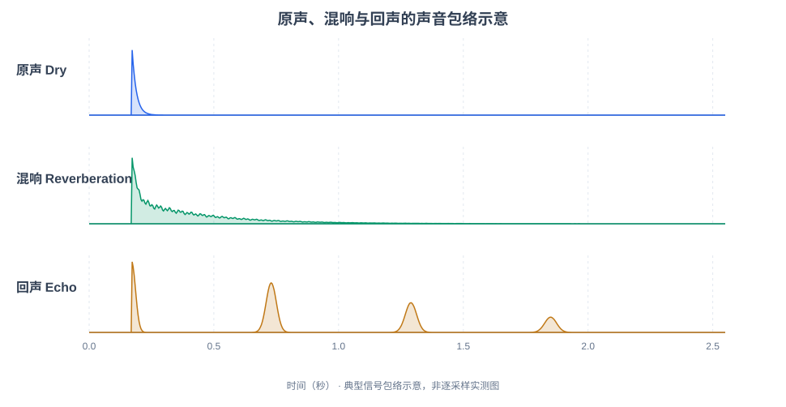

# 混响（Reverberation）与回声（Echo）：原理与音频对比实验

> **核心区别**：**混响**是大量反射声密集叠加，产生连续、逐渐衰减的声音拖尾；**回声**是延迟后的声音仍然能够被人耳分辨为重复。二者都源于声音的延迟传播和叠加，但听觉效果不同。

## 1. 先听音频，再看概念

以下音频**由同一段原始声音模拟生成**，分别加入房间混响或明显延迟的回声。全部为 **24 kHz / 单声道 / 16-bit PCM WAV**，不需要特殊播放器。

### 实验 A：拍手声（最容易分辨）

拍手声很短，尤其适合比较“连续拖尾”和“间隔重复”。建议先听 04、05、06，再听一次完整对比。

| 音频 | 播放 | 要注意听什么 |
| --- | --- | --- |
| 04 原声（Dry） | <audio controls preload="none" src="./reverb_echo_assets/audio/04_clap_dry.wav"></audio> [WAV](./reverb_echo_assets/audio/04_clap_dry.wav) | 一声短促的“啪”，很快停止。 |
| 05 混响（Reverb） | <audio controls preload="none" src="./reverb_echo_assets/audio/05_clap_reverb.wav"></audio> [WAV](./reverb_echo_assets/audio/05_clap_reverb.wav) | 一声“啪”后密集的沙沙声尾巴，逐渐消失。 |
| 06 回声（Echo） | <audio controls preload="none" src="./reverb_echo_assets/audio/06_clap_echo.wav"></audio> [WAV](./reverb_echo_assets/audio/06_clap_echo.wav) | 第一声之后，隔约 0.56 秒又出现清楚的“啪”。 |

**[连续试听：拍手声（原声 → 混响 → 回声）](./reverb_echo_assets/audio/08_clap_ABC.wav)**

如果页面没有显示音频播放器，可以点击文件链接，直接使用浏览器或本地播放器打开 WAV。

### 实验 B：人声（更接近实际 AFE / ASR 场景）

原始样本是模拟双音节的**合成人声近似音**（非自然语言 TTS），三段音频使用相同的原始合成声源。

| 音频 | 播放 | 要注意听什么 |
| --- | --- | --- |
| 01 原声（Dry） | <audio controls preload="none" src="./reverb_echo_assets/audio/01_voice_dry.wav"></audio> [WAV](./reverb_echo_assets/audio/01_voice_dry.wav) | 声音结束后很快安静。 |
| 02 混响（Reverb） | <audio controls preload="none" src="./reverb_echo_assets/audio/02_voice_reverb.wav"></audio> [WAV](./reverb_echo_assets/audio/02_voice_reverb.wav) | 语音模糊一些，结尾有延续的空间拖尾。 |
| 03 回声（Echo） | <audio controls preload="none" src="./reverb_echo_assets/audio/03_voice_echo.wav"></audio> [WAV](./reverb_echo_assets/audio/03_voice_echo.wav) | 再次听到分离出来的同一段合成声音。 |

**[连续试听：人声（原声 → 混响 → 回声）](./reverb_echo_assets/audio/07_voice_ABC.wav)**

### 包络示意图：三种效果的差异



图中横轴为时间，纵轴为**归一化示意幅度**；这张图展示声音包络的典型结构，不是当前 WAV 的逐帧实测值：

- **原声**：短促脉冲后迅速归零。
- **混响**：短脉冲后出现较连续的、整体衰减的能量拖尾。
- **回声**：在几个延迟时刻再次出现分离的峰。

## 2. 概念与对比

| 对比项 | 混响（Reverberation） | 回声（Echo） |
| --- | --- | --- |
| 核心听感 | 密集的反射声叠加、声音拖尾 | 听到一个或多个可辨认的重复声 |
| 典型环境 | 房间、教堂、会议室 | 山谷、远距离反射墙面 |
| 时间分布 | 各种延迟路径很密集，形成延续衰减 | 某些路径延迟较长、幅度明显 |
| 常用测量 | RT60、早期衰减时间等 | 回声延迟、幅度、回声路径损耗等 |
| 对语音识别 | 语音时间上的模糊、音节相互干扰 | 原语音的延迟重复可能干扰识别 |

混响并不只存在于尾音中：说话**正在进行时**，反射声也始终和当前声音叠加。尾音只是最容易察觉混响的时刻。

## 3. 混响形成原理

```text
说话人 / 扬声器
    ├── 直达声 ────────────────────────┐
    ├── 墙壁一次或少量反射（早期反射） ───┤→ 麦克风采集并叠加
    └── 多次反射（后期密集混响） ────────┘
```

房间声学常用卷积模型表达：

\[
 y(t)=x(t)*h(t)
\]

- \(x(t)\)：原始声音。
- \(h(t)\)：房间冲激响应（RIR），描述直达声、反射路径与衰减。
- \(y(t)\)：麦克风采集到的声音。
- \(*\)：卷积运算。

**RT60**：在标准的房间声学定义下，声源停止后，混响声压级衰减 **60 dB** 所对应的时间。RT60 越长，通常混响拖尾越明显。本实验的混响响应使用约 **1.3 秒**的设计衰减时间，仅用于听觉演示，并非真实房间的实测数据。

## 4. 回声形成原理

回声可以看成原始声音的延迟副本。例如：

\[
 y(t)=x(t)+a\cdot x(t-\tau)
\]

- \(a\)：回声的相对幅度。
- \(\tau\)：回声延迟时间。

本实验模拟了 **560 ms、1120 ms、1680 ms** 的三个逐渐变弱的重复声，所以能听到分离的“啪”或合成音。真实环境中，回声是否能够被明显分辨还取决于原始声音的长度、反射强度、背景噪声和听觉掩蔽。

## 5. 在语音 AFE / ASR 中如何处理

```text
人声 + 房间混响 + 扬声器回放串音 + 环境噪声
                      ↓
                  麦克风 PCM
                      ↓
                 AFE 音频前端
            ├── AEC：回声消除
            ├── Dereverb：去混响
            ├── NS：噪声抑制
            └── BF：波束形成（多麦）
                      ↓
                  VAD / KWS / ASR
```

这是一张**功能示意图**，并不表示这些模块有固定的执行顺序。

- **AEC（Acoustic Echo Cancellation）**：主要消除扬声器播放后被麦克风重新拾取的声学回声，通常使用扬声器参考信号。
- **Dereverb（Dereverberation）**：抑制目标说话人受到房间反射影响形成的混响，尤其是后期混响。
- **NS（Noise Suppression）**：抑制环境噪声。
- **BF（Beamforming）**：使用多路麦克风信号进行方向性增强。

**不要混淆**：AEC 中的“回声”即使包含房间内大量复杂反射，通常也称为声学回声；而这里试听的“回声”是专门用离散延迟模拟的**可听见的重复声**。

## 6. 一句话总结

> **混响**：声音后面跟着“密密的、连续变小的尾巴”。
>
> **回声**：声音过一会儿“又说了一遍”。

**建议验收方式**：听完 08 拍手对比音频后，不看标题也能判断：哪段有连续拖尾？哪段有清楚分开的重复声？

---

### 文件说明

- `audio/01_voice_dry.wav` 至 `audio/03_voice_echo.wav`：人声三组对比。
- `audio/04_clap_dry.wav` 至 `audio/06_clap_echo.wav`：拍手声三组对比。
- `audio/07_voice_ABC.wav`：人声 A/B/C 连续试听。
- `audio/08_clap_ABC.wav`：拍手声 A/B/C 连续试听。
- `reverb_echo_assets/images/waveform_comparison.svg`：波形对比图。

所有音频均为本实验程序合成，不含实际录音；混响/回声采用简化的线性模拟，仅用于原理学习。

> [在线 HTML 试听页面](./reverb-echo.html)。本站音频为重新合成的教学样例，混响通过短延时反馈扩散网络模拟。
