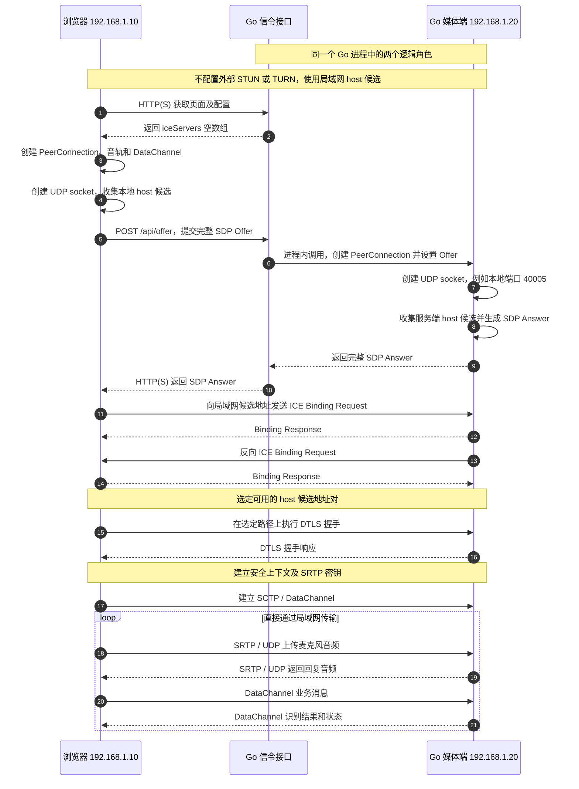
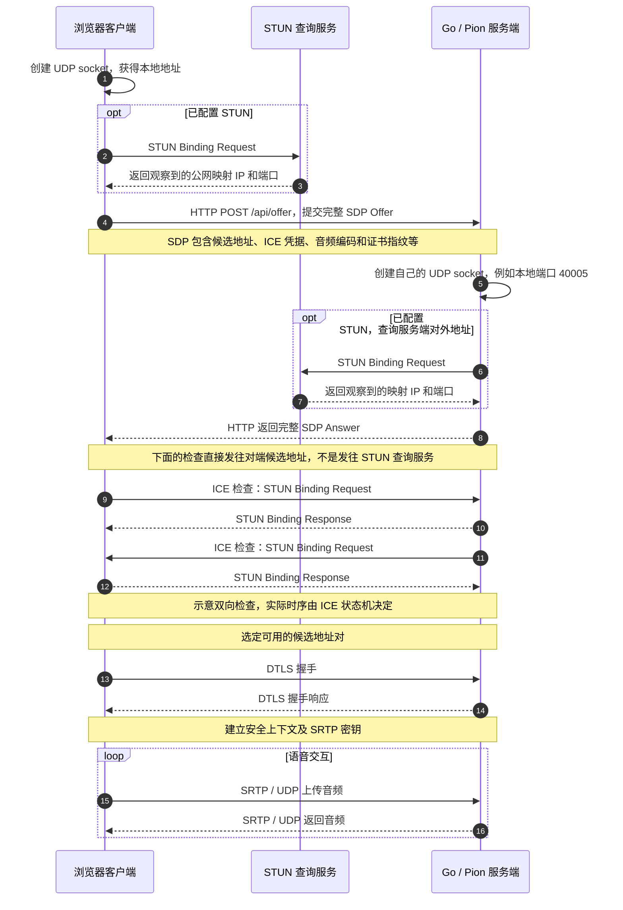
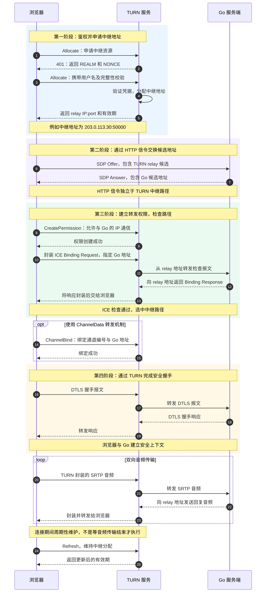
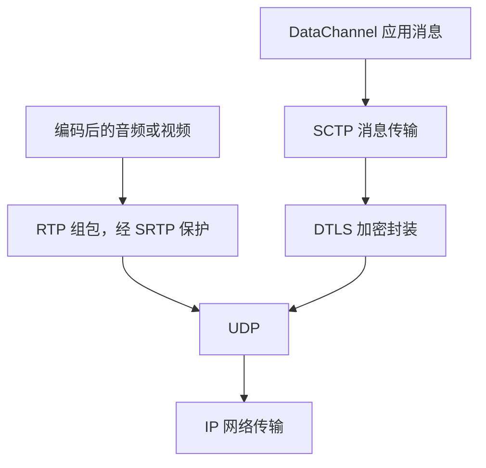

# WebRTC 协议全称、连接流程与数据传输总结

本文结合《WebRTC：STUN 查询、信令交换与 UDP 打洞》《WebRTC：TURN 中继使用流程》和提供的协议缩写图片，说明各术语的全称、职责及相互关系。示例以浏览器与 Go / Pion 语音服务通信为背景。

**整体过程：通过信令交换连接参数 → ICE 选出可用路径 → DTLS 建立安全上下文 → SRTP 传媒体，SCTP / DTLS 传 DataChannel 消息。**

## 1. 图片中的九个核心术语

| 缩写 | 英文全称 | 中文含义 | 在本例中解决什么问题 |
| --- | --- | --- | --- |
| ICE | Interactive Connectivity Establishment | 交互式连接建立 | 收集候选地址、配对、执行连通性检查并选定可用路径；是一套连接建立框架 |
| STUN | Session Traversal Utilities for NAT | NAT 会话穿越工具 | 用于打洞直连：向查询服务发现 NAT 映射地址；ICE 也使用 STUN 报文直接检查对端是否可达，辅助建立直连路径 |
| TURN | Traversal Using Relays around NAT | 通过中继穿越 NAT | 申请中继地址并转发数据，解决部分无法直连的情况 |
| NAT | Network Address Translation | 网络地址转换 | 将内外网地址进行转换；常见的端口转换型 NAT 还会转换端口。它是网络机制，不是 WebRTC 协议 |
| SDP | Session Description Protocol | 会话描述协议 | 用文本描述媒体、编码、传输方向等；在 WebRTC 中结合相关扩展携带 ICE 候选、凭据和证书指纹 |
| RTP | Real-time Transport Protocol | 实时传输协议 | 组织编码后的媒体数据，携带序号、时间戳、负载类型等，供接收方处理时序和媒体流 |
| SRTP | Secure Real-time Transport Protocol | 安全实时传输协议 | 为 RTP 媒体提供加密、完整性校验和防重放等保护；不是音频编码格式 |
| DTLS | Datagram Transport Layer Security | 数据报传输层安全 | 握手、身份验证和密钥协商；在 WebRTC 中为 SRTP 建立密钥材料，并保护 DataChannel 的 SCTP 数据 |
| SCTP | Stream Control Transmission Protocol | 流控制传输协议 | 提供面向消息的传输能力；WebRTC DataChannel 将其放在 DTLS 上使用 |

DTLS 可以类比为“适应数据报传输的 TLS”，但它不是普通 TLS 报文直接放进 UDP。DataChannel 是 WebRTC 的数据通道抽象/API，其底层使用 SCTP over DTLS，并不是 SCTP 协议的另一个名字。

标准对应：ICE 见 RFC 8445；STUN 见 RFC 8489；TURN 见 RFC 8656；SDP 见 RFC 8866；RTP 见 RFC 3550；SRTP 见 RFC 3711；SCTP 见 RFC 9260；DTLS-SRTP 见 RFC 5764。引用某个标准版本不表示当前 Demo 一定协商使用该协议的最新版本。

## 2. 相关基础协议与概念

| 名称 | 英文全称或名称说明 | 中文与职责 |
| --- | --- | --- |
| WebRTC | Web Real-Time Communication | Web 实时通信，包含浏览器 API 和一组网络协议，不是单个报文协议 |
| IP | Internet Protocol | 网际协议，负责网络寻址与数据包投递 |
| UDP | User Datagram Protocol | 用户数据报协议，不保证可靠、按序交付，通常适合实时媒体 |
| TCP | Transmission Control Protocol | 传输控制协议，提供可靠、有序的字节流；重传可能带来等待和队头阻塞 |
| TLS | Transport Layer Security | 传输层安全；本例用于 HTTPS 或 TURN-over-TLS 的安全传输 |
| HTTP | Hypertext Transfer Protocol | 超文本传输协议；本例用于页面、SDP 信令和语音后端请求 |
| HTTPS | HTTP over TLS | 通过 TLS 保护的 HTTP；不是 TURN TLS 的别名 |
| RTCP | RTP Control Protocol | RTP 控制协议，用于传输接收统计、质量反馈等信息，不承载主要音频负载 |
| SRTCP | Secure RTCP | 对 RTCP 的安全保护，与 SRTP 配套 |
| DataChannel | Data Channel | 数据通道，传输文字或二进制应用消息，例如 JSON 状态和识别结果 |

以下是媒体数据或软件组件，也不要与网络协议混淆：

| 名称 | 全称/类别 | 作用 |
| --- | --- | --- |
| PCM | Pulse-Code Modulation，脉冲编码调制 | 用采样值表示声音；本例业务处理的是 int16 PCM |
| PCMU | PCM μ-law，G.711 μ-law 编码 | 本例协商的音频编码：8 kHz、单声道，需要解码后才能得到线性 PCM |
| VAD | Voice Activity Detection，语音活动检测 | 判断是否有人声，配合静音时长完成切句 |
| Pion | Go WebRTC 协议实现库 | 处理连接、解密和媒体/消息收发，向业务代码暴露接口 |
| go-webrtcvad | WebRTC VAD 的 Go 封装 | 检测 PCM 中是否有语音，可与 Pion 配合，不负责 WebRTC 网络连接 |

## 3. 各协议按阶段如何配合

| 阶段 | 相关机制或协议 | 具体工作 |
| --- | --- | --- |
| 描述与协商 | SDP + HTTP/HTTPS 信令 | 双方交换媒体能力、候选地址、ICE 凭据和证书指纹；SDP 本身不发送声音 |
| 收集地址 | ICE、STUN、TURN | 收集本地地址、映射地址、中继地址 |
| 检查和选路 | ICE 使用 STUN 检查报文 | 检查候选地址对能否通信，再选定路径 |
| 安全建立 | DTLS / DTLS-SRTP | 建立安全上下文和 SRTP 密钥材料 |
| 实际传输 | SRTP / SRTCP；SCTP over DTLS | 发送受保护的音视频、媒体反馈和业务消息 |
| 连接维护 | ICE 连通性维护；TURN Refresh 等 | 维护路径、NAT 状态及中继分配和权限 |

WebRTC 没有规定信令必须使用 HTTP 或 WebSocket。本例选择 HTTP；其他实现可以用不同信令通道交换相同用途的参数。

### ICE 候选地址的四种类型

| 类型 | 名称 | 地址来源 |
| --- | --- | --- |
| `host` | Host Candidate，本机候选 | 网络接口上的本地地址，可能是内网或公网地址 |
| `srflx` | Server-Reflexive Candidate，服务器反射候选 | 通过 STUN 等服务获知的映射地址 |
| `prflx` | Peer-Reflexive Candidate，对端反射候选 | ICE 连通性检查过程中发现的新地址 |
| `relay` | Relayed Candidate，中继候选 | TURN 分配的中继地址 |

候选地址是“可能可用的联系地址”，不等于已经建立的连接。类型数量不等于实际候选数量：多个网卡、地址族和服务可能产生多个候选。

## 4. 连接流程：同网直连与 STUN 打洞

### 4.1 同一网络中的直连时序图

假设浏览器与 Go 位于同一局域网，内网地址和媒体 UDP 端口互通，配置 `iceServers: []`。双方可以使用 `host` 候选建立直接连接，无需外部 STUN 查询服务或 TURN 中继。即使同属一个局域网，客户端隔离或防火墙仍可能阻止直连。

图中将 Go 的信令接口和媒体端拆成两个逻辑泳道；实际可以位于同一个 Go 进程。地址和端口仅为示例。



这里仍然使用 STUN Binding 报文执行 **ICE 对端检查**，但不需要联系独立的 STUN 查询服务器，也无需建立跨 NAT 的打洞路径。图中按阶段展示处理过程，实际检查、握手与通道事件的先后可能交错。

浏览器麦克风采集仍要求安全上下文：使用受信任的 HTTPS，或浏览器认可的 `localhost` HTTP。单纯把服务部署在内网，并不会取消这项要求。

### 4.2 STUN 查询与 UDP 打洞时序图



**STUN 查询服务报告映射地址，不分配客户端的 NAT 地址，也不转发后续音频。**本地端口由本机 socket 创建过程决定；映射由路径上的 NAT 决定；Go 只创建自己的媒体 socket。

“打洞”不是发送一条路由器开端口命令。双方向对端候选地址发送检查报文，NAT 根据自身规则建立或更新状态。返回报文能否通过，仍受 NAT 映射和过滤策略影响。

向外部 STUN 查询服务发送 Binding Request 是为了发现地址；向实际通信对端发送 Binding Request 是为了执行 ICE 检查。两者使用同一种 STUN 方法，目的不同。查询成功不保证直连成功。

## 5. TURN 中继使用时序图

以下为浏览器使用一个 TURN 中继、Go 对端可直接访问的场景；实际还可以有双方均使用中继的组合。



| TURN 方法或消息 | 含义 |
| --- | --- |
| `Allocate` | 申请中继资源，获得 `relay` 地址和有效期 |
| `401` 鉴权挑战 | 常见长期凭据机制中返回 `REALM`、`NONCE`；客户端再提交带用户名及消息完整性校验的请求，不是明文传输密码 |
| `CreatePermission` | 允许与指定对端 IP 通信；权限本身按 IP 管理 |
| `ChannelBind` | 可选地把通道编号绑定到具体对端 IP:port，也会创建/刷新对应权限 |
| `Send Indication` / `Data Indication` | 不使用已绑定通道时，封装向对端发送或从对端收到的数据 |
| `ChannelData` | 使用绑定后的通道编号转发数据 |
| `Refresh` | 刷新或释放中继分配；权限和通道绑定还需按各自机制维护 |

TURN 的接入端口和分配的中继端口不同。例如浏览器向 `turn.example.com:3478` 申请服务，得到 `203.0.113.30:50000`，Go 对端则把后者作为浏览器的中继候选地址。

TURN 通常通过凭据控制使用权限。公共 STUN 地址查询通常不要求账号，但 STUN 协议本身支持鉴权，ICE 的对端检查也使用 ICE 凭据。选中 TURN 路径后，加密媒体持续经 TURN 转发，不会在握手完成后自动改为直连。

## 6. 五种网络路径有什么区别？

| 路径 | 浏览器到 Go 的数据经过哪里 | 是否需要媒体中继 |
| --- | --- | --- |
| 可达地址直连 | 浏览器 ↔ Go | 否 |
| NAT 打洞直连 | 浏览器 ↔ NAT/路由器 ↔ Go | 否；NAT/路由器不等于 TURN 中继 |
| TURN UDP | 浏览器 ←UDP→ TURN ←UDP→ Go | 是 |
| TURN TCP | 浏览器 ←TCP→ TURN ←UDP→ Go | 是 |
| TURN TLS | 浏览器 ←TLS/TCP→ TURN ←UDP→ Go | 是 |

这里的三种 TURN 路径均指常见的 UDP 中继分配：改变的是客户端到 TURN 的承载方式，TURN 到对端仍是 UDP。其他 TURN 扩展不在本例范围内。

TCP 的可靠、按序交付可能造成丢包重传等待；TLS/TCP 另外提供到 TURN 的传输加密和证书验证。TURN-over-TCP 不等于 ICE-TCP 直连打洞。

这些差别不只存在于 ICE 阶段。选中的路径还承载后续 DTLS 握手、SRTP 和 DataChannel 数据；除非后续重新选路或重建连接，否则不会因为进入音频传输阶段就自行更换路径。

## 7. 媒体与 DataChannel 的封装、加密

下面是 UDP 直连时的简化协议栈。箭头表示发送方向上的处理或封装，不表示网络中的多跳转发。



| 通道 | 封装关系 | 加密方式 |
| --- | --- | --- |
| 媒体 | 编码媒体 → 受 SRTP 保护的 RTP → UDP/IP | SRTP 保护媒体；DTLS 握手提供密钥材料 |
| 媒体反馈 | RTCP → SRTCP → UDP/IP | SRTCP 保护反馈信息 |
| DataChannel | 应用消息 → SCTP → DTLS → UDP/IP | SCTP 数据由 DTLS 加密 |

**音频包不是逐包再包一层 DTLS。**SRTP 媒体和 DTLS 记录是不同的报文格式，DataChannel 才是将 SCTP 数据装在 DTLS 记录中。采用 BUNDLE、RTCP-mux 等协商后，它们可共享底层传输，但共享端口不等于数据格式相同。

使用 TURN 后，客户端到 TURN 这段在上述 WebRTC 数据外增加 TURN 转发封装；TURN TLS 再提供外层 TLS。外层 TLS 的端点是浏览器和 TURN；WebRTC 的 DTLS/SRTP 端点仍是浏览器和 Go。

## 8. `iceServers`、协议前缀与端口

`iceServers` 配置的是辅助服务，不是对端媒体地址，也不是固定顺序的尝试列表。

```javascript
const pc = new RTCPeerConnection({
  iceServers: [
    { urls: "stun:rtc.example.com:3478" },
    {
      urls: [
        "turn:rtc.example.com:3478?transport=udp",
        "turn:rtc.example.com:3478?transport=tcp",
        "turns:rtc.example.com:5349?transport=tcp"
      ],
      username: "用户名",
      credential: "密码"
    }
  ]
});
```

服务身份由 `stun:`、`turn:`、`turns:` 前缀决定，不由数组下标决定。标准还定义 `stuns:`，具体客户端是否支持应验证。地址需替换为实际可用服务。

| 用途 | 本例或常见端口 | 注意事项 |
| --- | --- | --- |
| 页面、SDP 信令、会话 HTTP 接口 | Demo 默认 TCP 8080 | HTTPS 可另配；不是音频上传端口 |
| ICE 检查、DTLS、媒体和 DataChannel | Go 本地 UDP 40000–40100 | 是可分配范围；选中的实际端口不一定等于 NAT 公网映射端口 |
| STUN / TURN UDP 接入 | 常见 UDP 3478 | 由实际服务配置决定 |
| TURN TCP 接入 | 常见 TCP 3478 | 客户端到中继使用 TCP |
| TURN TLS 接入 | 常见 TCP 5349，也可实际部署在 443 | 必须提供 TURN TLS 服务；不是普通 HTTPS 网站 |
| TURN 中继地址 | 例如 UDP 50000 | 属于分配的中继端口范围，与接入端口不同 |
| Go 调用语音后端 | 示例 TCP 8090 | 与浏览器的媒体连接分开 |

端口示例不代表所有 WebRTC 应用都固定使用这些端口。浏览器通常使用临时源端口。TCP 443 可达也不保证 TURN TLS 一定能通过网络的应用层策略。

## 9. 对 Go 业务代码意味着什么？

只要媒体编码和应用消息格式保持一致，直连或不同 TURN 路径不会改变 Pion 交付给业务的数据类型。

| 接口 | 业务拿到什么 | 下一步处理 |
| --- | --- | --- |
| `TrackRemote.ReadRTP()` | 已完成 SRTP 解密的 RTP 包 | 取 `Payload`；本例 PCMU 解码为 PCM，再做 VAD/ASR |
| `DataChannel.OnMessage()` | 已完成底层重组和解密的应用消息 | 从 `msg.Data` 解析 JSON 或处理二进制数据 |

媒体和 DataChannel 彼此不是相同格式；这里说的是“同一通道在不同网络路径下，业务接收格式保持一致”。不同路径仍可能带来不同的延迟、丢包和吞吐表现。

当前 Demo 的边界：默认 `iceServers` 为空；媒体协商仅启用 PCMU/8000/单声道；Go 配置的是 IPv4 UDP 的 ICE 网络类型，未开启直接 ICE-TCP；双方等待候选收集结束，再通过 HTTP 一次性交换完整 SDP，未使用 Trickle ICE。图中 STUN、TURN 阶段需要相应配置才会发生。
